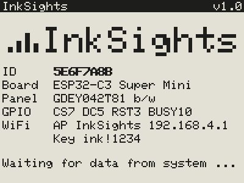
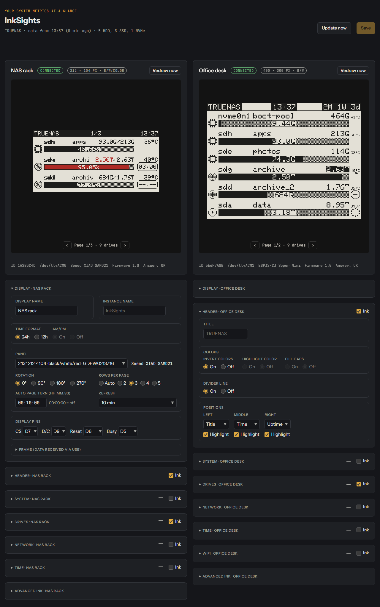

<h1></h1>

Repository: https://github.com/Gittegatt/InkSights

Shows the drive status of a system on small e-paper displays, typically a server and often a NAS, and on request
a system page with CPU, RAM, network and drive temperatures, network pages, a WiFi page and a clock. Every display hangs on its own small board, plugged
into the server via USB or (boards with WiFi) running anywhere in reach of the WiFi. All settings are made on a small web page.


More pictures: [examples](examples/)

**Contents**

- [Getting started](#getting-started)
- [What a display shows](#what-a-display-shows)
- [Supported hardware](#supported-hardware)
- [How it fits together](#how-it-fits-together)
- [1. Wiring](#1-wiring)
- [2. Upload the firmware](#2-upload-the-firmware)
- [3. Set up on the NAS server](#3-set-up-on-the-nas-server)
- [4. WiFi (optional)](#4-wifi-optional)
- [5. The settings page](#5-the-settings-page)
- [Update](#update)
- [System page](#system-page)
- [Good to know](#good-to-know)
- [Troubleshooting](#troubleshooting)
- [Protocol (for the curious)](#protocol-for-the-curious)
- [License](#license)
- [AI Notice](#ai-notice)
- [Support the project](#support-the-project)

## Getting started

1. **Wire** the display to its board ([1. Wiring](#1-wiring)).
2. **Upload the firmware** to the board ([2. Upload the firmware](#2-upload-the-firmware)).
3. **On the NAS server** ([3. Set up on the NAS server](#3-set-up-on-the-nas-server)):
   get the files (`git clone`), create the data folder on an SSD for the app user, start the Docker app, start the
   script as root.
4. **Plug the board into the NAS server** via USB, or set up its WiFi ([4. WiFi](#4-wifi-optional)).
5. **Open the settings page** at `http://<server>:8099`, choose the panel type and everything else
   ([5. The settings page](#5-the-settings-page)).

## What a display shows

Per drive one row:

- **Symbol:** chip = SSD/NVMe, grey disc = hard disk spinning, light disc = hard disk asleep (can be switched off)
- **Device name** (e.g. `sda`), **pool** and **used/total**, e.g. `3.18T/8.95T`
- **Usage bar** (free = grey raster), highlighted from 85 % (third colour, inverted on black/white panels),
  optionally with the percentage (whole or with decimals) or the used capacity inside the bar
- **Temperature** of each drive (optional), `--` or `STBY` for a hard disk that is asleep
- **Spindown timer** for hard disks at the right end of the bar (optional, off by default): a **badge** with the time left (MM:SS, "SLEEP" when
  asleep) or a **ring** that shrinks until spindown (dotted when asleep)


The top line shows the time, the title (default: InkSights) and the uptime; the page number instead or
as well, any order, highlighted or not, white on black or inverted, in the third colour on colour panels, or no top
line at all (see [Header card](#header-card)). If not all drives fit on one page, the display turns pages by itself.
Besides the drive pages a display can show a **system page** (see [System page](#system-page)), **network pages**
with one row per interface (see [Network card](#network-card)), a **time page** (see [Time card](#time-card)) and a
**WiFi page**, each switched on or off per display, in any order (by default: time, system, drives, network, WiFi).


Works on any Linux NAS server with bash and lsblk (e.g. TrueNAS SCALE, Debian, Proxmox, Unraid), with ZFS pools
and with any other Linux filesystem (ext4, XFS, btrfs, also on RAID or LVM).

## Supported hardware

### Panels

The panel type is chosen on the settings page (**Panel** in the Display card), by the name printed on the flat
cable of the display. Every firmware drives all of them.

| Panel | Size | Colours | Fast refresh |
|---|---|---|---|
| GDEW0213Z16 (older MH-ET LIVE modules) | 2.13″ 212×104 | black/white/colour (red or yellow) | – |
| GDEH0213Z19 | 2.13″ 212×104 | black/white/colour | – |
| GDEY0213Z98 (newer modules) | 2.13″ 250×122 | black/white/colour | – |
| GDEY0213B74 | 2.13″ 250×122 | black/white | ✓ |
| GDEY042T81 (e.g. with the DESPI-C02 adapter) | 4.2″ 400×300 | black/white | ✓ |

**Fast refresh:** black/white panels redraw in under a second without flashing. Three-colour panels always need a
full refresh (about 15 seconds, flashing), even when they only show black and white.

### Boards

| Board | WiFi | PlatformIO environment |
|---|---|---|
| Seeed XIAO SAMD21 | – | `xiao-samd21` |
| Seeed XIAO ESP32-C3 | ✓ | `seeed-xiao-esp32-c3` |
| Seeed XIAO ESP32-S3 | ✓ | `seeed-xiao-esp32-s3` |
| ESP32-S3 Super Mini | ✓ | `esp32-s3-supermini` |
| Waveshare ESP32-S3-Zero | ✓ | `esp32-s3-zero` |
| ESP32-C3 Super Mini | ✓ | `esp32-c3-supermini` |
| Waveshare ESP32-C3-Zero | ✓ | `esp32-c3-zero` |
| Adafruit QT Py ESP32-S3 N4R2 | ✓ | `adafruit-qtpy-esp32-s3-n4r2` |
| Adafruit QT Py ESP32-S3 No PSRAM | ✓ | `adafruit-qtpy-esp32-s3-nopsram` |

Untested on real hardware so far: the black/white panels and drawing on the ESP32 boards.

### Spindown timer (separate project)

The spindown timer and the spinning/asleep symbols need
[sata-sas-spindown-timer](https://github.com/Gittegatt/sata-sas-spindown-timer) **v1.1.0 or newer**.
It writes the status file this project reads. Without it the display shows `--:--` (or a circle with a dash).

## How it fits together

```
Script on the NAS server (loop or cron) ──USB──> board 1 ──> e-paper (e.g. HDDs)
        │                               ──USB──> board 2 ──> e-paper (e.g. SSD + NVMe)
        │ reads settings, writes current data
        ▼
  Data folder on an SSD  <──── Docker app "settings page" (http://<server>:8099) <──WiFi── board 3 ──> e-paper
```

| Path | Content |
|---|---|
| `firmware/InkSights/` | Arduino sketch, the same for every board (`BoardProfile.h`: pins per board) |
| `platformio.ini` | PlatformIO environments, one per board |
| `scripts/` | builds the ready-made firmware files of a release (`build_release.py`) |
| `server/inksights.sh` | collects the data and sends every display its frame |
| `server/web/` | settings page (`inksights-web.py`, `index.html`, `inksights-ui.js`, `inksights-render.js`, `inksights.css`; `inksights-usb.js` for the USB setup) |
| `server/docker/docker-compose.yaml` | Docker stack that runs the settings page |
| `simulator/simulator.html` | the settings page with simulated displays and data, opens in a browser straight from the folder |
| `examples/` | pictures of what the displays show |
| `LICENSE`, `licenses/` | the license, GPL-3.0, and the license of the Adafruit font ([License](#license)) |
| `usb-setup.html` | sets up a board over USB from a PC: panel type, pins, WiFi ([USB setup](#usb-setup); code in `server/web/inksights-usb.js`) |

## 1. Wiring

- Leave switch **BS1 on L** (4-line SPI).
- Connect VCC to **3V3**, not 5V (the boards' pins only tolerate 3.3V).
- SCLK and SDI are fixed per board. CS, D/C, Reset and Busy have defaults and can be changed on the settings page.

| Board | SCLK | SDI | CS | D/C | Reset | Busy |
|---|---|---|---|---|---|---|
| XIAO SAMD21 | D8 | D10 | D7 | D9 | D6 | D5 |
| XIAO ESP32-C3 | D8 (GPIO8) | D10 (GPIO10) | D7 (GPIO20) | D9 (GPIO9) | D6 (GPIO21) | D5 (GPIO7) |
| XIAO ESP32-S3 | D8 (GPIO7) | D10 (GPIO9) | D7 (GPIO44) | D9 (GPIO8) | D6 (GPIO43) | D5 (GPIO6) |
| ESP32-S3 Super Mini, ESP32-S3-Zero | GPIO12 | GPIO11 | GPIO10 | GPIO9 | GPIO8 | GPIO7 |
| ESP32-C3 Super Mini | GPIO4 | GPIO6 | GPIO7 | GPIO5 | GPIO3 | GPIO10 |
| ESP32-C3-Zero | GPIO4 | GPIO6 | GPIO7 | GPIO5 | GPIO3 | GPIO1 |
| QT Py ESP32-S3 (both) | SCK (GPIO36) | MO (GPIO35) | A2 (GPIO9) | A3 (GPIO8) | A0 (GPIO18) | A1 (GPIO17) |

On the XIAO boards the 3V3/GND side has D7–D10, so only Reset and Busy go to the other side.

**Reset and Busy are optional.** Set them to **None** on the settings page and 6 wires are enough. Drawbacks: the
display waits fixed times while drawing instead of using the ready signal, and it cannot go into deep sleep.
Connecting them is still recommended.

**XIAO ESP32-C3:** the default D/C pin D9 is a boot pin. It works as D/C, but if the board does not start with the
display connected, choose another pin for D/C on the settings page.

**4.2″ with the DESPI-C02 adapter:** check the resistor switch on the adapter against the documentation of
Good Display for the GDEY042T81, and insert the flat cable with the contacts facing the right way.

## 2. Upload the firmware

The same firmware goes on **every** board. Only the board is chosen when building; the panel type and the pins are
chosen later on the settings page.

### Easiest: ready-made files, nothing to install

Download the file of your board from the [releases](https://github.com/Gittegatt/InkSights/releases). The name
ends with the PlatformIO environment of the board ([Boards](#boards)), e.g.
`inksights-v1.0-esp32-c3-supermini-factory.bin`.

**ESP32 boards (`-factory.bin`) in the browser** with [ESPWebTool](https://esptool.spacehuhn.com/) (Chrome or Edge):

1. Plug in the board, click **Connect** and choose its port. Not found: hold BOOT while plugging in.
2. Keep only one file row and delete all others.
3. Set its address to `0x0000` (if `0x` is already shown in front, enter only `0`) and choose the `-factory.bin`.
4. Click **Erase**. This also removes pins, panel type and WiFi settings stored on the board.
5. Connect again if asked, then click **Program**.
6. If the board does not restart by itself, press RESET or plug it in again.

The factory image holds everything the board needs at the right places. Always flash it as one file at `0x0000`,
never split it up.

**XIAO SAMD21 (`.uf2`) by drag and drop:**

1. Plug in the board and press RESET twice quickly (the two pads next to the USB port; touch them twice with
   tweezers or a wire). The orange LED pulses and a drive named **Arduino** appears.
2. Copy `inksights-v1.0-xiao-samd21.uf2` onto that drive.
3. The board restarts with the new firmware by itself; the drive disappears.

`SHA256SUMS.txt` in the release lists the checksums of all files.

**Build the files yourself:** `python scripts/build_release.py` builds every board and writes the files to
`dist/v<version>/` (`--environment <env>` for one board only). Pushing a tag such as `v1.0` to GitHub builds them
there as well and creates a draft release with them.

### With PlatformIO or the Arduino IDE

**With PlatformIO (VS Code):** open the project folder, pick the environment of your board
([Boards](#boards)) and upload, e.g. `pio run -e esp32-c3-supermini -t upload`.
If the port is not found: SAMD21 press RESET twice quickly, ESP32 hold BOOT while plugging in.

**With the Arduino IDE:**

1. Boards:
   - XIAO SAMD21: under *File → Preferences → Additional boards manager URLs* add
     `https://files.seeedstudio.com/arduino/package_seeeduino_boards_index.json`, then install "Seeed SAMD Boards"
     and select **Seeeduino XIAO**.
   - ESP32 boards: install "esp32" by Espressif, select the board (XIAO_ESP32C3, XIAO_ESP32S3, Adafruit QT Py
     ESP32-S3; for the Super Mini and Zero boards "ESP32S3 Dev Module" or "ESP32C3 Dev Module"),
     and set *Tools → USB CDC On Boot* to **Enabled**. Generic S3 / C3 selections are taken as the Super Mini;
     for a Zero board add `#define INKSIGHTS_BOARD_ESP32_S3_ZERO` (or `..._C3_ZERO`) at the top of the sketch.
2. *Library manager*: install **GxEPD2** and **Adafruit GFX Library**, for the SAMD21 also **FlashStorage** (by cmaglie).
3. Open `firmware/InkSights/InkSights.ino` and upload it.

**Start screen.** After power-up every display shows a start screen until the first data arrives (below the top
line the name InkSights in big letters with its logo); it can be switched off in the [Advanced Ink card](#advanced-ink-card):

```
InkSights                    v1.0
           InkSights
ID     1A2B3C4D
Board  ESP32-C3 Super Mini
Panel  GDEW0213Z16 b/w/color
GPIO   CS7 DC5 RST3 BUSY10
WiFi   AP InkSights 192.168.4.1
       Key ink!1234
Waiting for data from system ...
```

The **ID** is the chip ID. Note which ID belongs to which display; the settings page lists the displays by it.
The WiFi lines only appear on boards with WiFi. A new board starts with the first panel type (GDEW0213Z16).

**What a new upload keeps:**

| | SAMD21 | ESP32 boards |
|---|---|---|
| Pins and panel type | back to the defaults | kept |
| WiFi settings | – | kept |
| Start from scratch | upload again | erase the flash: `pio run -e <env> -t erase -t upload` |

## 3. Set up on the NAS server

The menu paths below are from **TrueNAS SCALE 25.10**. Other systems name them differently; the steps are the
same: create a folder, start the Docker app, run the script as root.

The examples use this layout. Adjust the paths to your system:

| What | Where |
|---|---|
| Project (from GitHub) | `/home/truenas_admin/inksights/` (script: `server/inksights.sh`) |
| Docker stack | `/mnt/apps/docker/stacks/inksights/` |
| Data folder (web page files, settings, state) | `/mnt/apps/docker/data/inksights/` |

### a) Get the files

As your normal user (e.g. `truenas_admin`), one of these:

**With git (recommended, updates later with one command):**

```
git clone https://github.com/Gittegatt/InkSights.git /home/truenas_admin/inksights
```

**Without git, with curl** (only the files the NAS server needs, same folders):

```
B=https://raw.githubusercontent.com/Gittegatt/InkSights/main/server
mkdir -p /home/truenas_admin/inksights/server/web /home/truenas_admin/inksights/server/docker
cd /home/truenas_admin/inksights/server
curl -fsSLO "$B/inksights.sh"
curl -fsSL -o docker/docker-compose.yaml "$B/docker/docker-compose.yaml"
for f in inksights-web.py index.html inksights-ui.js inksights-render.js inksights.css; do curl -fsSL -o "web/$f" "$B/web/$f"; done
```

**Or as a ZIP:** on GitHub *Code → Download ZIP*, unpack it and copy its content to
`/home/truenas_admin/inksights/` (e.g. over a network share).

For the spindown timer on the display, the spindown timer project must be running as well
(see [Spindown timer](#spindown-timer-separate-project)).

### b) Create the data folder on an SSD

The settings page and the script keep their files here. **Not on hard disks**, otherwise the writes wake them up.
The container runs as the **app user `568`** (on TrueNAS the user `apps`) and needs write access to the folder.

```
sudo mkdir -p /mnt/apps/docker/data/inksights/web
sudo cp /home/truenas_admin/inksights/server/web/* /mnt/apps/docker/data/inksights/web/
sudo chown -R 568:568 /mnt/apps/docker/data/inksights
```

**Check the app user:**

```
id apps                                                    # TrueNAS: uid=568(apps) gid=568(apps)
ls -ln /mnt/apps/docker/data/inksights                     # owner and group: 568 568
sudo -u apps touch /mnt/apps/docker/data/inksights/.test && echo "app user can write" && sudo rm /mnt/apps/docker/data/inksights/.test
```

- `id apps` shows another number: use that one in `chown` and as `PUID`/`PGID` (see c).
- `chown` says *Operation not permitted*, or the app user cannot write: the dataset has a restricted ACL. TrueNAS:
  *Datasets* → the dataset → *Permissions* → *Edit*, owner user and group `apps`, tick *Apply recursively*, save.
- Other systems: use a user that owns the folder and set it with `PUID`/`PGID` (see c).

Also check where Docker keeps its data (TrueNAS: *Apps → Configuration → Choose Pool*).
If that is on hard disks, the app wakes them up as well.

### c) Start the settings page as a Docker app

`docker-compose.yaml` contains no system-specific paths. Its settings come from a `.env` file next to it:

| Setting | Meaning | Default |
|---|---|---|
| `DATA_DIR` | data folder from b) | `./data` (next to the compose file) |
| `PORT` | port of the settings page | `8099` |
| `PUID` / `PGID` | user/group the container runs as, needs write access to `DATA_DIR` | `568` (TrueNAS apps user) |
| `RUN_DIR` | run folder of the script (in memory, frames for WiFi displays), read-only for the app | `/var/run/inksights` |

```
sudo mkdir -p /mnt/apps/docker/stacks/inksights
sudo cp /home/truenas_admin/inksights/server/docker/docker-compose.yaml /mnt/apps/docker/stacks/inksights/
echo "DATA_DIR=/mnt/apps/docker/data/inksights" | sudo tee /mnt/apps/docker/stacks/inksights/.env
cd /mnt/apps/docker/stacks/inksights && sudo docker compose up -d
```

Or start it with your stack manager (most of them read the `.env` file or have a field for these values).
With the TrueNAS app list instead: *Apps → Discover Apps* → three dots at the top right → **Install via YAML**,
name `inksights` (app names must be lowercase), paste the content of `docker-compose.yaml`.
There is no `.env` file there, so replace `${DATA_DIR:-./data}` with the full path of the data folder
(`${RUN_DIR:-/var/run/inksights}` can stay as it is).

The page is then reachable at **http://&lt;server&gt;:8099**. On its first start the app creates the settings file
`inksights.conf` in the data folder (with the defaults; an existing one is never overwritten). If the app cannot
write to the data folder, the settings page says so at the top. If it does not start, look at its messages:
`sudo docker logs --tail 20 inksights` (*Permission denied* = see "Check the app user" in b).

### d) Run the script regularly (as root)

The script runs once and exits. Start it again and again, either as a loop in tmux or as a cron job.
Use only one of the two.

| | Loop in tmux (recommended) | Cron job |
|---|---|---|
| Runs | every 10 s, every second with fast refresh | once a minute |
| Display plugged in or out | noticed within about 20 s | noticed within about a minute |
| Fast refresh | ✓ | – |

**Option 1: loop in tmux.** TrueNAS: *System → Advanced Settings → Init/Shutdown Scripts → Add*, Type `Command`,
When `Post Init`, Timeout `10`:

```
tmux has-session -t inksights 2>/dev/null || tmux new-session -d -s inksights "/bin/bash /home/truenas_admin/inksights/server/inksights.sh -l -d /mnt/apps/docker/data/inksights"
```

Post Init scripts run as root. To start it now without a reboot, run the same line in a root shell (`sudo -i`).
Check with `tmux ls` as root. If you used an older line (with `while true; ... sleep 10` or `| tee -a …`),
stop it first (`tmux kill-session -t inksights`) and use this one.

**Option 2: cron job.** TrueNAS: *System → Advanced Settings → Cron Jobs → Add*

- Command: `bash /home/truenas_admin/inksights/server/inksights.sh -d /mnt/apps/docker/data/inksights`
- User: `root`
- Schedule: every minute (`* * * * *`)
- Tick "Hide Standard Output" and "Hide Standard Error"

Other systems: the same line with `* * * * *` in root's crontab (`sudo crontab -e`).

**The data folder after `-d` must be the one from b).** Otherwise the log says
`Data folder … not found`: the displays still get data, but without your settings, and the settings page stays empty.

**What the script does.** It almost always does nothing and exits right away. A full update (drives, pools, system
values, the settings page) happens as often as the shortest **Refresh** of your displays (one under a minute counts
as 1 minute), after saving on the settings page, when a display is plugged in or out, or on "Update now" /
"Redraw now". In a full update every display whose own **Refresh** has passed gets a frame, after a change all of
them. In between, displays with a refresh in seconds get a new frame with fresh system values and spindown timers
(the time left counts down between the polls of the spindown timer, its next poll corrects it); disk and pool data
then come from the last full update.

**Log:** the script keeps its log in memory at `/var/run/inksights/inksights.log` (the last 2000 lines, gone after
a reboot): `sudo tail -f /var/run/inksights/inksights.log`. With the loop it also shows in the tmux session
(`sudo tmux attach -t inksights`, leave with Ctrl+B, then D).

**Dry run** (prints what every display would get, sends nothing):
`sudo bash /home/truenas_admin/inksights/server/inksights.sh -d /mnt/apps/docker/data/inksights -n`

**Files in memory** (gone after a reboot) in `/var/run/inksights/`: `system.json` (the latest system values, also
usable by other tools), `inksights.log` (the log), `counters` and `temps` (previous readings), `disks.cache`, `fast`,
`frames/` (the frames of the WiFi displays, read by the settings page), `live/`, `stamp` and `lock`. Displays on USB get their frame
directly; only for one with fast refresh a copy goes to `live/` (without WiFi settings), for the live preview.

## 4. WiFi (optional)

Boards with WiFi work over USB without any WiFi setup. To run a display over WiFi (it then only needs power):



1. **Set up the WiFi**, either
   - **on the settings page** while the board is plugged into the NAS server: open its **WiFi** card, enter the WiFi
     network, password and the address of the settings page (e.g. `http://192.168.1.10:8099`), *Save*. The settings
     go to the board over USB with the next update; or
   - **on the board itself:** without a WiFi network the board opens its own access point **InkSights**
     (password **ink!1234**, also on the start screen). Connect your phone to it; the setup page opens by itself.
     That can take a moment: a few seconds on most phones, up to about a minute right after the board started while
     it is still drawing its start screen. If nothing opens, open **http://192.168.4.1** yourself.
     Pick your network from the list (**Search** looks again) and enter the same values there; or
   - **over USB from any PC** with the [USB setup](#usb-setup) page, together with the panel type and the pins.
2. The board connects, shows its address on the start screen and fetches its data from the settings page about
   every 30 seconds (with fast refresh as often as set). Unplug it from the NAS server and give it power anywhere in
   reach of the WiFi.

If the WiFi is lost for 30 seconds (**Access point after (s)**, 0 = at once), the board opens the access point again
(unless switched off) and closes it once it is connected again. While connected, its own page at
`http://inksights-<id>.local` or its address shows the status and lets you change the WiFi settings.

WiFi passwords are stored in the settings file of the data folder (readable only for the app and root) and never
shown on the settings page again. They are sent to a board only over USB, never over WiFi.

### USB setup

`usb-setup.html` (in the project folder) sets up a board straight over its USB port from any PC, without the NAS
server: the **panel type**, the **display pins** and, on boards with WiFi, all **WiFi settings**. It needs Chrome or
Edge (Firefox and Safari cannot use USB from a web page) and works when the file is opened from disk (double-click
it) or over https, e.g. `https://gittegatt.github.io/InkSights/usb-setup.html`. Not from the settings page of the
NAS server (http): browsers allow USB only on such "secure" pages.

1. Plug the board into the PC (the InkSights firmware must be on it, see [2.](#2-upload-the-firmware)).
2. Open the page, click **Connect** and choose the board's port.
3. The page shows what the board reports (ID, board, firmware, panel, pins, WiFi state and network) and fills in its
   settings. Change what you need, **Save**.
4. WiFi settings are taken at once. New pins or a new panel type make the board restart; the page connects again by
   itself. Afterwards it shows what the board stored.

Empty password fields keep the stored passwords (the board never reports them). The page sends nothing anywhere
but to the board. If the board later goes back to the NAS server and its WiFi card on the settings page holds WiFi
settings, those are sent to it again with the next update.

GitHub Pages: in the repository *Settings → Pages*, *Deploy from a branch*, branch `main`, folder `/ (root)`. The
page and the simulator are then online at `https://<user>.github.io/<repository>/usb-setup.html` and
`…/simulator/simulator.html`.

## 5. The settings page

Open **http://&lt;server&gt;:8099**. Every display appears with a live preview of what it will show, and below it its own
foldable cards **Display**, **Header**, **Time**, **System**, **Drives**, **Network**, (boards with WiFi) **WiFi** and **Advanced Ink**. A new
display starts with every page on (time, system, drives, network, WiFi) and these settings: top line with time,
title and uptime, black, no divider line, nothing highlighted; time page without top line, weekday and date
(`2026-10-26`), zone UTC, no NTP; every system row, no ZFS RAM cache, asleep hard disks `STBY`; every drive type,
the percentage with one decimal in the bar, temperatures on, no spindown timer, highlight from 85 %; network pages
with symbols and the percentage in the bar; WiFi page with symbols, setup access point on after 30 s. Change settings,
*Save*, and the NAS server applies them within a minute. The page itself shows no explanations, to keep it tidy; they
are here. Which cards are folded is remembered per browser.

**Order of the pages:** the cards **System**, **Drives**, **Network**, **Time** and **WiFi** have a grip (two
horizontal lines left of **Ink**). Drag a card by it up or down, or click the grip and use the arrow keys. The order of these cards is
the order of the pages on the display (default: time, system, drives, network, WiFi); *Save* applies it.
**Display**, **Header** and **Advanced Ink** stay in their place.



**At the top of the page** (for all displays):

- **Update now**: sends fresh values to all displays right away. How often each display gets fresh values is set in
  its card (**Refresh**).
- **New version:** the page asks GitHub for the latest InkSights release when it is opened (at most every 6 hours;
  your browser does that, the NAS server does not). When it is newer than the installed version, a line shows it:
  **Download** opens the release page, **Mute** hides it until the page is opened again, **Skip version** hides it
  until a newer version is released.

**Backup** (in the Advanced Ink card of each display): **Export** saves the settings of this display as a JSON file
`inksights-v<version>-<name>-<chip id>-<date>.json` (e.g. `inksights-v1.0-living-room-1a2b3c4d-2026-10-26.json`; the name
only when the display has one), with the InkSights version it was made with. WiFi passwords are not in it: they never reach the
page. **Import** reads such a file into this display, also one of another board (e.g. after replacing a board, which
has a new chip ID). It is checked first (an InkSights backup of a display, then every setting by the app with the
same rules as saving; settings a backup of an older version does not have get their defaults). A valid file
becomes this display's settings on the page as unsaved changes, its display name included: check the preview (and
the display pins, when it came from another kind of board) and press **Save**. The WiFi passwords stored on the NAS
server stay.

**In each display card:** the preview (‹ › turns its pages), **Redraw now** (redraws this display within a minute,
even if nothing changed and without waiting for the 3 minutes) and a line with ID, port, board, firmware and the
display's last answer.

### Display card

| Setting | Options | Notes |
|---|---|---|
| **Display name** | up to 32 characters | Name of the display on this page (card heading). Empty = the title, else "Display <ID>". |
| **Instance name** | up to 32 characters | One setting for the whole page, shown in every card: name in the page header and browser tab (empty = InkSights). The name on the display's start screen is `PRODUCT_NAME` at the top of the `.ino`. |
| **Time format** | 24h, 12h | The time in the top line and on the time page. With 12h, **AM/PM** On shows `1:37PM` (top line) and `1:37 PM` (time page), Off only `1:37`. |
| **Panel** | the panel types ([Panels](#panels)) | By the name on the flat cable; next to it the board. The board saves it and restarts with it (over USB with the next update, over WiFi with its next fetch). Preview, rows and fast refresh follow it. |
| **Rotation** | 0°, 90°, 180°, 270° | Clockwise. 90° and 270° stand the display upright: device and used/total in the first line, the pool in its own line. |
| **Rows per page** | Auto, 2–5 (6 on the 4.2″) | More rows fit more disks per page. Fewer rows: bigger bar, symbols and timer (readable from further away). |
| **Auto page turn** | HH:MM:SS | 00:00:00 = always page 1. The display redraws at most every 3 minutes, so shorter times act like 00:03:00 (not with fast refresh). |
| **Refresh** | 1, 3, 5, 10, 15, 30 min, 1, 1.5, 2, 3, 4 h; black/white panels also 2, 5, 10, 30 s | How often this display gets fresh values (default 10 min). Colour panels redraw at most every 3 minutes and only on changes, so 1 min gets changes there as fast as possible. **Seconds** (fast refresh, only black/white panels): the display gets a new frame this often and redraws the changed parts without flashing; a full refresh on page turns and every 10 minutes against ghosting. Needs the loop (`-l`). The preview then follows the display just as often (live, the frame it was sent), except while settings are changed and not saved. |
| **Display pins** | CS, D/C, Reset, Busy | Only the pins the board allows; Reset and Busy can be None. The board stores new pins and restarts once. |
| **Frame** | – | What the display receives (over USB or WiFi). |
| **Remove settings** | – | Only for displays that are not connected: forget their settings. |

### Header card

The top line of the display. Its settings stand in four frames: **Title**; the colours (Invert colors, Color
highlight, Fill gaps); **Divider line**; the places (Left, Middle, Right).

| Setting | Options | Notes |
|---|---|---|
| **Ink** | tick | Shows the top line or not; its settings stay. Without it the rows get its room. "NO DATA" still shows it. |
| **Title** | up to 12 characters | Empty = InkSights. |
| **Invert colors** | On, Off | On: white top line with black text and a thin black line below it; highlighted places then black with white text. |
| **Color highlight** | On, Off | Only with **Invert colors** on a colour panel: the highlighted places in the third colour (red or yellow) with white text, on yellow black text. |
| **Fill gaps** | On, Off | Only with **Invert colors** and **Color highlight** on a colour panel: the whole top line in the third colour (red or yellow), every place drawn like a highlighted one, no gaps between them; the **Highlight** ticks then have no effect. Off by default. (On black/white it would be the same as switching **Invert colors**.) |
| **Divider line** | On, Off | The line between the top line and the page (off by default): with **Invert colors** a thin black line below it; on the black top line its black edge below the highlighted places (Off: they reach down to its edge). 2 px on the 4.2". |
| **Left**, **Middle**, **Right** | Title, Pages, Uptime, Time, None | What stands where. Choosing what already stands in another place swaps the two. None = nothing there. Default: Time, Title, Uptime. |
| **Highlight** | tick, for each place | The place in the opposite colours: black text on a white box (with **Invert colors**: white on black). |

The time page has no top line unless the Time card's **Header** is ticked.


- **Pages** is the page number (e.g. 1/3), only with more than one page. **Uptime** is how long the NAS server has
  been running. **Time** is when the data were sent.
- Left and right stand at the edges, the middle one in the middle as long as there is room. Only the title is cut
  where room is short; the others leave at least 5 of its characters where they can.
- **Uptime** is shown in the three biggest units, e.g. `1W 5d 4h`, `2M 1W 3d` or `1Y 2M 3W`; where room is short the
  smallest unit on the right goes first (`2M 1W`, `2M`). Y = year, M = calendar month (counted by the date: from
  15 March to 15 April is one month), W = week, d = day, h = hour, m = minute.
- **NO DATA** (see [Good to know](#good-to-know)) stands in the place of Pages, else of Uptime, else in a free place.

### System card

| Setting | Options | Notes |
|---|---|---|
| **Ink** | tick | Shows the system page on the display or not; its settings stay. |
| **Components** | CPU, RAM, Network, NVMe, SSD, HDD, any combination | The ticked rows form an extra page (by default after the time page); none = no system page. The number of drives of each type is shown in brackets. HDD needs [drive-temp-export](#hdd-temperatures). |
| **Network** | Default, the interfaces found | The interface shown; Default = the one with the default route. |
| **ZFS RAM cache** | On, Off | Off: no grey part in the RAM bar, the cache counts as free. |
| **HDD asleep** | --, STBY | What the HDD row shows for a hard disk that is asleep. The same setting as **Asleep** in the Drives card. |
| **Icons** | On, Off | Symbol at the left of each row. |

### Drives card

| Setting | Options | Notes |
|---|---|---|
| **Ink** | tick | Shows the drive pages on the display or not; their settings stay. |
| **Drive types** | HDD, SSD, NVMe, any combination | The number of drives of each type is shown in brackets. None = no drive pages. With every page off the display shows "Nothing to ink" with a small picture of three people sitting about (on colour panels the bottle on their table in the third colour). |
| **Icons** | On, Off | Symbol left of each bar. |
| **Details in bar** | On, Off | Text inside the bar, only where the bar is high and wide enough. |
| **Details** | Percentage, Capacity | Percentage used (e.g. 35%) or the used capacity (e.g. 3.18T). With the capacity in the bar, the top right shows only the total. |
| **Percentage** | 35%, 35.4%, 35.47% | Decimals of the percentage in the bar (cut, not rounded, so 99.99% is never shown as 100%). Where the bar is too short, fewer decimals are shown. More decimals change more often, so the display redraws more often (at most every 3 minutes). |
| **Spindown timer** | On, Off | Hard disks only. Off = no timer, full-width bar. |
| **Timer style** | Badge, Ring | Badge: time left as MM:SS. Ring: shrinks until spindown. |
| **Ring direction** | Clockwise, Counterclockwise | For the ring. |
| **Temperature** | On, Off | The temperature of each drive at the right of its first text line, above the timer (upright in the pool line); `--` = unknown. Without the timer, used/total moves left to make room. Hard disks need [drive-temp-export](#hdd-temperatures). |
| **Asleep** | --, STBY | What a hard disk that is asleep shows instead of its temperature. The same setting as **HDD asleep** in the System card. |
| **Color highlight** | on/off, from … % used | Bar and used/total are highlighted once a pool is this full: in the third colour on colour panels, inverted on black/white panels. |
| **Order and visibility by** | Pool, UID, Device, Custom (▲▼) | The tick next to each disk shows or hides it on this display. Names like sda can change after a reboot, so Pool, UID and Custom use the serial number (UID); Device orders by name. |


### Network card


Pages with one row per network interface (by default after the drive pages), as many rows per page as the drive pages.

| Setting | Options | Notes |
|---|---|---|
| **Ink** | tick | Shows the network pages or not; their settings stay. |
| **Icons** | On, Off | Symbol left of each row: linked boxes for a wired interface, the WiFi symbol for a wireless one. |
| **Details in bar** | On, Off | Text inside the bar, only where the bar is high and wide enough. |
| **Details** | Percentage, Link speed | How busy the link is (e.g. 10%) or its speed (e.g. 1G). |
| **Order and visibility by** | Name, Custom (▲▼) | The tick next to each interface shows or hides it. At most 8 interfaces are shown. |

Each row shows the interface, ↓ download and ↑ upload per second and a bar with the busier direction of the link
speed (none without a link speed, e.g. bridges or WiFi: the values stand below the name). An interface that is
switched off shows **down**, one without a connection (no cable, or WiFi not connected to a network) **no link**,
in the place of the bar. The same goes for the network row of the system page. Virtual interfaces (Docker, VMs)
are left out.

### Time card

A page with the time in big, below it the weekday and the date (each when ticked); by default the first page. **Ink** switches it on or off. 12 or 24 hours: **Time format** in the Display card.


| Setting | Options | Notes |
|---|---|---|
| **Time zone** | about 50 common zones | Only with NTP; summer time included. |
| **Date format** | 26 Oct 2026, 2026-10-26, 10/26/2026, 26.10.2026 | Only with Date. |
| **Show** | Date, Weekday, Header | Below the time the date and the weekday short (`Mon`). **Header** (off by default): the time page with the top line; off, it has none (the other pages keep theirs). With **Just give me time** (Advanced Ink) it decides whether the display has a top line at all. |
| **NTP** | On, Off | Off (default): the local time of the NAS server, which comes with every update; the board counts on by itself, so the time stays right between updates. On (boards with WiFi only): the board sets its clock from the NTP server itself. |
| **NTP server** | e.g. `pool.ntp.org`, `0.pool.ntp.org` … `3.pool.ntp.org`, or any name or IP address | Only with NTP. A click on the field lists the pool servers. |
| **Color highlight** | tick | Colour panels only: the time in the third colour (red or yellow); weekday and date stay black. |
| **Time frame** | tick | Only with **Color highlight**: a black outline around the digits of the time, so a light colour such as yellow stays easy to read. |

The time in the top line always is the time of the last update from the NAS server. A black/white panel redraws
the time page every minute (without flashing); a colour panel redraws at most every 3 minutes, so its clock moves on
in steps of 3 minutes.

### WiFi card

Boards with WiFi only: network, password, settings page, host name, setup access point on/off, access point after (s),
access point name and password. See [4. WiFi](#4-wifi-optional).

| Setting | Options | Notes |
|---|---|---|
| **Ink** | tick | An extra page (by default the last) with the rows **WiFi** (network, or the setup access point), **IP** (address) and **Connected** (how long the board has been connected without a break). The WiFi settings apply either way. |
| **Icons** | On, Off | Symbol at the left of each row. |

The WiFi page is shown in the preview so far; the firmware does not draw it yet.


### Advanced Ink card

Four framed sections:

- **Pages**: **Just give me time** (off by default) shows only the time page: the cards Header, System, Drives,
  Network and WiFi are hidden and the Time card's **Ink** is ticked (and stays ticked while this is on); the top
  line is shown as the Time card's **Header** tick says (off by default). Their settings stay, so switching it off
  brings the header and the pages back as they were.
- **Screens**: which of the three special screens a display shows when they apply (all ticked by default).
- **Bar behaviour**: **Auto collapse**.
- **Backup** of the display's settings (see above).

| Setting | Notes |
|---|---|
| **Start screen** | Off: after power-up the board draws nothing, the panel keeps its last picture until the first data arrive. The board stores this setting, so it applies from the next power-up on. A board with WiFi whose time page uses NTP also stores the clock: it then shows the time right after power-up, even without the NAS server (once NTP has the time). |
| **Nothing to ink** | Off: with every page switched off the display shows only its top line. |
| **No connection** | Off: without fresh data the display goes on showing its pages (and turning them) instead of NO DATA and Check connection. |
| **Auto collapse** (Bar behaviour) | On (default): opening a card of this display folds its other cards, so only one is open at a time. Remembered in this browser (not in the backup), no need to save. |

### Simulator


`simulator/simulator.html` opens in any browser straight from the folder. It is the same settings page with simulated
data. Below the displays, the **Simulation** section sets the simulated boards, panels and connections, the system
values (incl. when the server started; **Live values** = a running system: displays with a refresh in seconds show changing system values, drive temperatures and counting-down spindown timers, as often as they refresh), the drives (with or without ZFS, each with a temperature, column **Temp °C**), or a frame pasted from a dry run.
A display with **Connected** off shows what it draws when it gets no fresh data any more (NO DATA, Check connection), **No data** at a connected one the "Nothing to ink" screen (nothing to show), **Start screen** what it shows
after power-up until the first data arrive. The simulated interfaces cover every case: wired, no cable, switched
off, a bridge and WiFi. **Update notice · Test** shows the line about a new version (one version after the installed
one, or after a skipped one). **Versions** sets the version of the WebUI and of the script, and per display the version of its
firmware: below the status line the page then shows which versions run, and a notice for every one that does
not match the WebUI, with **Latest release** (the release page on GitHub). At the bottom of the page the card
**About** shows the versions, links to the project, the license with the libraries used, and how to support the
project. Both only in the simulator so far. The Simulation card folds (the triangle next to its heading). The panel choices of the simulator also hold the
colour panels with yellow instead of red (preview only so far).
Nothing is sent anywhere, except to a board on USB: the **USB** card at the bottom is the [USB setup](#usb-setup),
plus **Send to display**: it sends what a simulated display gets to the real board, so the display shows it right
away (without "NO DATA" later, as the simulated time does not move). Chrome or Edge only.

## Update

```
cd /home/truenas_admin/inksights && git pull                                   # with curl / ZIP: get the files again as in 3 a)
sudo cp /home/truenas_admin/inksights/server/web/* /mnt/apps/docker/data/inksights/web/
sudo chown -R 568:568 /mnt/apps/docker/data/inksights
sudo docker restart inksights                                                   # settings page
sudo tmux kill-session -t inksights                                             # script: stop it ...
```

... and start it again with the line from [3 d)](#d-run-the-script-regularly-as-root) (with cron there is nothing to
do). If `server/docker/docker-compose.yaml` changed, take the changes over into your stack and deploy it again.
Then reload the settings page in the browser (Ctrl+F5). New firmware: upload it as in
[2.](#2-upload-the-firmware); the settings stay (on the SAMD21 the NAS server sends pins and panel type again).

## System page

One extra page (by default after the time page) with the ticked rows; sizes like a drive page with as many rows:

| Row | Left | Middle | Right | Bar |
|---|---|---|---|---|
| CPU | `CPU` | temperature, power | load | load |
| RAM | `RAM` | ZFS RAM cache (shown as `ZFS`) | used by programs / total | black = programs, grey = ZFS RAM cache, light = free |
| Network | interface | ↓ download per second | ↑ upload per second | the busier direction of the link speed (none without a link speed, e.g. bridges); "down" / "no link" instead when the interface is off or has no connection |
| NVMe | `NVMe` | temperature of each NVMe drive | – | – |
| SSD | `SSD` | temperature of each SATA / SAS SSD | – | – |
| HDD | `HDD` | temperature of each hard disk, `--` or `STBY` when asleep | – | – |

- With **Icons** on, each row gets a symbol: a processor for CPU, a memory module for RAM, linked boxes for the
  network, the chip for NVMe and SSD and the disc for HDD: the light disc of a sleeping hard disk when all of them
  are asleep, the grey disc of a spinning one as soon as one runs.
- Temperatures stand after the name (upright: below it), at most six per row. A temperature row without such drives
  is left out, and the other rows get bigger.
- The network row without a link speed shows its values below the name instead of a bar. A wireless interface gets
  the WiFi symbol instead of the linked boxes.

All values come from `/proc` and `/sys`, never from the hard disks:

- **RAM:** ZFS uses almost all free memory as cache and gives it back when programs need it, so it is shown apart
  (can be switched off per display). Systems without ZFS simply show no cache.
- **Power:** what the processor itself uses (Intel, newer AMD), not the whole server. Not available in virtual machines.
- **CPU temperature:** Intel (`coretemp`), AMD (`k10temp`, `zenpower`) or the CPU sensor of ARM boards.
- **NVMe temperature:** read from the NVMe driver at most every 30 seconds (a tiny request to the NVMe drive; no
  moving parts, it does not wake anything).
- **SSD temperature:** only when a display shows the SSD row, at most every 30 seconds, with `smartctl` (TrueNAS has
  it; without it the row stays empty). Only drives the system reports as SSD are asked, with `-n standby` (a drive
  that says it is asleep is not asked). Hard disks are never asked.
- **HDD temperature:** see below.
- Load, power and network are averages since the previous reading: over seconds with fast refresh, otherwise since
  the last update. Unknown values show `--` or are left out.
- The preview on the settings page shows the values of the last full update.

### HDD temperatures

InkSights never asks a hard disk anything itself, so it does not wake one. It takes hard disk temperatures from
[drive-temp-export](https://github.com/Gittegatt/drive-temp-export), a separate tool that asks only spinning hard disks (`smartctl -n standby`: a sleeping disk is
not asked) and writes a status file. When that tool runs on the NAS server, InkSights reads its status file
`/run/system-metrics/output/disk-temp/status` (another place: set `DRIVE_TEMP_STATUS` for the script):

- a disk the tool reports as active shows its temperature, one that is asleep (for the tool or for the spindown
  timer) shows `--`, or `STBY` with **Asleep** / **HDD asleep** set to STBY;
- a status file older than 5 minutes counts as missing: then the HDD row of the system page is left out and the drive
  pages show `--` for hard disks.

SSD and NVMe temperatures do not need it.

## Good to know

- **Does not wake disks.** The script only reads ZFS data from memory, `/proc`, `/sys`, filesystem usage (`df`) and the
  status file of the spindown timer. It never queries the hard disks itself; SSDs only for their temperature. Hard
  disk temperatures come from the status file of drive-temp-export (see [HDD temperatures](#hdd-temperatures)).
- **Usage = pool usage.** ZFS spreads data over all disks of a pool, so all disks of a pool show the same bar; the
  same goes for one RAID or one btrfs filesystem over several disks.
- **Disks outside ZFS** show the biggest filesystem mounted on them (or on their partitions, RAID or LVM), named after
  its mount point (`/` = `root`). A disk with nothing mounted shows its size and "not mounted" instead of a bar.

  

- **Spares the panel.** A display does not redraw when nothing changed, and never more often than every 3 minutes;
  with several pages it turns one page per redraw. Only "Redraw now" skips both. A **Refresh** of 1 min gets
  changes there as fast as possible. With a refresh in seconds (black/white panels) it redraws as often as set.
- **NO DATA.** E-paper keeps its picture even without power, so a display that gets nothing any more would look
  the same as one that works. Without fresh data for twice its **Refresh** plus 2 minutes (at least 10 minutes;
  e.g. 22 minutes at 10 minutes, 8 hours 2 minutes at 4 hours), the display shows **NO DATA** in the top line, where the page number
  or the uptime stands, and **Check connection** in the middle below a picture of the empty table, and stops turning pages. The time at the top right
  stays: that is when the last data came. With the next fresh data the pages come back. Reasons: the board is
  unplugged or the NAS server is off, the script or the settings page does not run, or a WiFi board lost its WiFi.

  

- **Nothing to ink.** With every page of a display switched off (no system, drive, network, time or WiFi page), it shows
  **Nothing to ink** below a picture of three people at a table, so it never looks broken.

  

- **Refresh in seconds and minutes:** a display on seconds gets fresh system values and timers that often; its
  drives and pools come from the full updates, at least once a minute while such a display is there.
- **The app is isolated.** It has no USB access and no rights on the NAS server; it only shares the data folder with
  the script. The script checks its settings strictly and never executes any of it.
- **Anyone who can open the page on your network can change the display settings.** Nothing more. The same goes for
  a board's own WiFi page.

## Troubleshooting

| Problem | What to do |
|---|---|
| Something does not work as expected | Look at the log: `sudo tail -n 50 /var/run/inksights/inksights.log` |
| Picture shifted, cut off or just noise | The panel type does not match: choose the next type under **Panel** and save; the board restarts with it. |
| Display does not appear on the settings page | Is the script running as root (`tmux ls`)? Is the board plugged in? A board with an old firmware shows up as "No answer with chip ID": upload the firmware again. |
| **NO DATA** and "Check connection" | The display got no fresh data for a while. Is the script running as root (`tmux ls`)? Is the board plugged in? WiFi boards: is the WiFi there, does the settings page run (`sudo docker ps`)? See "NO DATA" in [Good to know](#good-to-know). |
| `--:--` (badge) or a circle with a dash (ring) | The spindown timer is not running, or its status file is older than two rounds. The symbol then shows the last known state. |
| Setup page of the board does not open | Wait up to a minute after power-up, or open **http://192.168.4.1** yourself while connected to **InkSights**. |
| Port not found when uploading | SAMD21: press RESET twice quickly. ESP32: hold BOOT while plugging in. |
| XIAO ESP32-C3 does not start with the display connected | Choose another pin than D9 for D/C on the settings page. |
| Hard disks wake up | Data folder and Docker data must be on an SSD (see 3 b). |
| Settings page does not start, or *Save* fails | Look at `sudo docker logs --tail 20 inksights`. *Permission denied*: the app user cannot use the data folder, see "Check the app user" in 3 b). |
| Log says `Data folder … not found`, settings page shows old data | The script was started with another folder after `-d` than the data folder of the app. Fix the line in 3 d) and start it again. |

## Protocol (for the curious)

```
PING                                   -> PONG InkSights id=1A2B3C4D size=212x104 colors=3 rows=4 pins=7,9,6,5 panel=1 board=xiao-samd21 wifi=0 fw=1.0
#BEGIN
H|HDD|14:30|5|85|0|600
D|sda|data|3.18T|8.95T|35|3|10|A
#END                                   -> OK disks=1 page=1/1 refresh=now
```

**PONG:** `colors=3` colour panel, `colors=2` black/white; `panel=` the panel type 1–5 (order of the [Panels](#panels)
table). A WiFi board also reports `net=sta|ap|off`, `ip=…` and its stored WiFi settings without the passwords
(`ssid=`, `host=`, `server=`, `apssid=` hex encoded and only when set, `ap=1|0`, `apdelay=`, `pass=1|0` = a password is
stored); a panel with fast refresh adds `fast=1`.

| Line | Fields | Notes |
|---|---|---|
| `H` | title, time, rows, highlight from %, quarter turns, page turn in seconds [, timer, ring direction, symbols, details in the bar, fast refresh, uptime, uptime months, WiFi page, no data after, header layout, drive pages, network details, network symbols, drive temperatures, asleep, header inverted, header colour, time format, screens, divider line, page order, time page header, header fill] | The last twenty-three are optional: timer 0 badge / 1 ring; ring direction 0 clockwise / 1 counterclockwise; symbols 1 on / 0 off; details in the bar 0 none / 1 percentage / 2 used capacity; fast refresh in seconds, 0 = off; uptime in minutes after the full calendar months, -1 = none; full calendar months; WiFi page 0 off / 1 with symbols / 2 without; seconds without fresh data before "NO DATA", 0 = never; header left, middle, right as three letters: `T` title, `P` page number, `U` uptime, `C` time, `-` nothing, lower case = highlighted (default `TCP`, `---` = no top line); drive pages 1 on / 0 off (with no system or network page either: "Nothing to ink"); network pages: details in the bar 0 none / 1 percentage / 2 link speed, symbols 1 on / 0 off; drive temperatures 1 on / 0 off (the D lines then carry them); asleep hard disks 1 `STBY` / 0 `--`; top line 1 inverted (white) / 0 black; inverted top line: highlighted places 1 in the third colour / 0 black; time format 0 24 hours / 1 12 hours with AM/PM / 2 12 hours without; screens shown when needed 1 start screen + 2 Nothing to ink + 4 Check connection (default 7); divider line below the top line 1 / none 0 (default 1); page order: `S` system, `D` drives, `N` network, `T` time, `W` WiFi, each once (default `SDNTW`); time page with the top line 1 / without 0 (default 0); top line filled in the third colour 1 / 0 (default 0, sent only with header inverted and header colour). |
| `D` | device, pool, used, total, percent, filled boxes, total boxes, state, seconds until spindown, timeout seconds [, °C] | °C only with drive temperatures on, -1 = unknown, -2 = asleep (older firmware shows `--`). The boxes are no longer drawn. Seconds until spindown -1 = timer not running. State: `A` spinning, `S` asleep, `N` SSD/NVMe, `?` unknown, `-` timer off (HDDs only). Percent may have one or two decimals (cut) for the text in the bar; -1 = no pool and nothing mounted (total = the size of the disk, or `-`). |
| `S` | rows, CPU %, CPU °C, CPU W, RAM used MiB, ZFS cache MiB, RAM total MiB, interface, down KiB/s, up KiB/s, link Mb/s, NVMe °C,…, SSD °C,… | Only with the system page. Rows: `C` CPU, `R` RAM, `N` network, `V` NVMe, `S` SSD, `H` HDD (temperatures in the `T` line), `I` = symbols on, `W` = the interface is wireless, `D` / `L` = it is down / has no link. -1 = unknown, `-` = none; at most six temperatures each. |
| `C` | local date and time `YYYYMMDDHHMMSS`, date 1/0, weekday 1/0, date format 0–3, NTP 1/0, NTP server, POSIX time zone [, time in the third colour 1/0, black outline 1/0] | Only with the time page; without NTP the board counts on from the date and time; server and zone `-` without NTP. The outline only with the colour; both only on colour panels. |
| `T` | HDD °C,… | After the `S` line, only with the HDD row and drive-temp-export running; -1 = unknown, -2 = asleep, at most six. |
| `N` | interface, down KiB/s, up KiB/s, link Mb/s, wireless 1/0, state | Only with the network pages, one per interface, at most 8. State: `U` up, `L` no link, `D` down. |
| `P` | CS, D/C, Reset, Busy [, panel] | Only when pins or the panel type are set on the settings page. Pin numbers of the board (D numbers on the SAMD21, GPIO numbers on the ESP32 boards). New values → store and restart. |
| `W` | network, password, host, settings page, access point 1/0, access point name, access point password, access point after (s) | USB only, boards with WiFi; texts hex encoded. |
| `R` | – | Only after "Redraw now": redraw right away, even without changes and before the 3 minutes are up. |

WiFi boards fetch the same frame with `GET /api/frame?id=…&size=…` from the settings page; their answer goes along
with the next request.

## License

Copyright 2026 Gittegatt

InkSights is free software: you can redistribute it and/or modify it under the terms of the
[GNU General Public License version 3](https://www.gnu.org/licenses/gpl-3.0.html) (GPL-3.0) as published by
the Free Software Foundation. The full text is in [LICENSE](LICENSE).

InkSights is distributed in the hope that it will be useful, but WITHOUT ANY WARRANTY; without even the implied
warranty of MERCHANTABILITY or FITNESS FOR A PARTICULAR PURPOSE. See the GNU General Public License for more
details.

The firmware uses [GxEPD2](https://github.com/ZinggJM/GxEPD2) (GPL-3.0), the
[Adafruit GFX Library](https://github.com/adafruit/Adafruit-GFX-Library) (BSD, including its 5x7 font, which the
settings page uses as well), [Adafruit BusIO](https://github.com/adafruit/Adafruit_BusIO) (MIT) and, on the
SAMD21, [FlashStorage](https://github.com/cmaglie/FlashStorage) (LGPL-2.1). They remain subject to their
respective licenses. The license of the Adafruit font is in [licenses/adafruit-gfx-bsd.txt](licenses/adafruit-gfx-bsd.txt).

## AI Notice

AI-assisted coding tools were used during the development of this project.

Use of this source code, including for AI or machine-learning training, fine-tuning, dataset creation, and model
improvement, is subject to the terms of the GNU General Public License version 3.

This notice does not impose any additional restrictions, does not apply to third-party material beyond its
respective terms, and does not override applicable statutory rights or exceptions.

## Support the project

If you enjoy the project and would like to support its development, a small contribution is always appreciated.

[Star on GitHub](https://github.com/Gittegatt/InkSights)

[Support on Ko-fi](https://ko-fi.com/gittegatt)

[Support on PayPal](https://paypal.me/gittegatt)
