<h1></h1>

Repository: https://github.com/Gittegatt/InkSights [](https://github.com/Gittegatt/InkSights/releases/latest)

InkSights shows the drive status of a server, often a NAS, on small e-paper displays. On request also:

- a **system page** with CPU, RAM, network and drive temperatures
- **network pages**, a **WiFi page** and a **clock**

Every display hangs on its own small board: plugged into the server via USB, or (boards with WiFi) anywhere in
reach of the WiFi. All settings are made on a small web page.

InkSights is **highly customizable**, per display: which pages, in which order, what the top line shows, colours,
symbols, sizes and more.

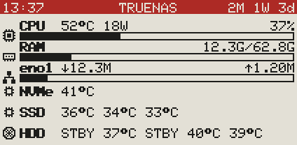

More pictures: [examples](examples/README.md)

**Contents**

- [Getting started](#getting-started)
- [What a display shows](#what-a-display-shows)
- [Supported hardware](#supported-hardware)
- [How it fits together](#how-it-fits-together)
- [1. Wiring](#1-wiring)
- [2. Upload the firmware](#2-upload-the-firmware)
- [3. Set up on the system](#3-set-up-on-the-system)
- [4. WiFi (optional)](#4-wifi-optional)
- [5. The settings page](#5-the-settings-page)
- [Update](#update)
- [System page](#system-page)
- [Good to know](#good-to-know)
- [Security](#security)
- [Troubleshooting](#troubleshooting)
- [Protocol (for the curious)](#protocol-for-the-curious)
- [License](#license)
- [AI Notice](#ai-notice)
- [Support the project](#support-the-project)

## Getting started

1. **Wire** the display to its board ([1. Wiring](#1-wiring)).
2. **Upload the firmware** to the board ([2. Upload the firmware](#2-upload-the-firmware)).
3. **On the system** ([3. Set up on the system](#3-set-up-on-the-system)):
   - get the files (`git clone`)
   - create the data folder on an SSD for the app user
   - start the Docker app (settings page and script)
4. **Plug the board into the system** via USB, or set up its WiFi ([4. WiFi](#4-wifi-optional)).
5. **Open the settings page** at `http://<server>:8099` and choose the panel type and everything else
   ([5. The settings page](#5-the-settings-page)).

## What a display shows

One row per drive:

- **Symbol:** chip = SSD/NVMe, grey disc = hard disk spinning, light disc = hard disk asleep (can be switched off)
- **Device name** (e.g. `sda`), **pool** and **used/total**, e.g. `3.18T/8.95T`
- **Usage bar:** free = grey raster; highlighted from 85 % (third colour, inverted on black/white panels);
  optionally the percentage (whole or with decimals) or the used capacity inside the bar
- **Temperature** of each drive (optional): `--` or `STBY` for a hard disk that is asleep
- **Spindown timer** for hard disks at the right end of the bar (optional, off by default):
  - a **badge** with the time left (MM:SS, "SLEEP" when asleep), or
  - a **ring** that shrinks until spindown (dotted when asleep)

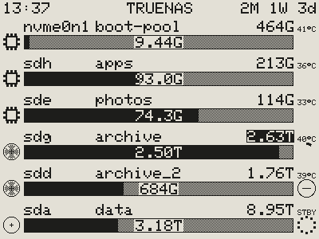

**The top line** shows the time, the title (default: InkSights) and the uptime. The page number can stand instead or
as well, in any order. Highlighted or not, black or white, in the third colour on colour panels, or no top line at
all (see [Header card](#header-card)).

**More pages:** if not all drives fit on one page, the display turns pages by itself. Each display can also show:

- a **system page** (see [System page](#system-page))
- **network pages** with one row per interface (see [Network card](#network-card))
- a **time page** (see [Time card](#time-card))
- a **WiFi page**

Each page is switched on or off per display, in any order (by default: time, system, drives, network, WiFi).

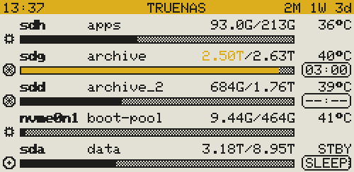

**Works on any Linux system** with bash and lsblk (e.g. TrueNAS SCALE, Debian, Proxmox, Unraid): with ZFS pools
and with any other Linux filesystem (ext4, XFS, btrfs, also on RAID or LVM).

## Supported hardware

### Panels

The panel type is chosen on the settings page (**Panel** in the Display card), by the name printed on the flat
cable of the display. Every firmware drives all of them.

| Panel | Size | Colours | Fast refresh |
|---|---|---|---|
| GDEW0213Z16 (older MH-ET LIVE modules) | 2.13″ 212×104 | black/white/red | - |
| GDEH0213Z19 | 2.13″ 212×104 | black/white/red | - |
| GDEY0213Z98 (newer modules) | 2.13″ 250×122 | black/white/red | - |
| GDEY0213B74 | 2.13″ 250×122 | black/white | ✓ |
| GDEY042T81 (e.g. with the DESPI-C02 adapter) | 4.2″ 400×300 | black/white | ✓ |
| GDEW0213Z16, GDEH0213Z19, GDEY0213Z98 with yellow | as above | black/white/yellow | - |

The yellow versions are driven like the red ones; the list shows them as "black/white/yellow". Text on the third
colour is black there instead of white, so it stays easy to read.

**Fast refresh:**

- Black/white panels redraw in under a second without flashing.
- Three-colour panels always need a full refresh (about 15 seconds, flashing), even when they only show black and
  white.

### Boards

| Board | WiFi | PlatformIO environment |
|---|---|---|
| Seeed XIAO SAMD21 | - | `xiao-samd21` |
| Seeed XIAO ESP32-C3 | ✓ | `seeed-xiao-esp32-c3` |
| Seeed XIAO ESP32-S3 | ✓ | `seeed-xiao-esp32-s3` |
| ESP32-S3 Super Mini | ✓ | `esp32-s3-supermini` |
| Waveshare ESP32-S3-Zero | ✓ | `esp32-s3-zero` |
| ESP32-C3 Super Mini | ✓ | `esp32-c3-supermini` |
| Waveshare ESP32-C3-Zero | ✓ | `esp32-c3-zero` |
| Adafruit QT Py ESP32-S3 N4R2 | ✓ | `adafruit-qtpy-esp32-s3-n4r2` |
| Adafruit QT Py ESP32-S3 No PSRAM | ✓ | `adafruit-qtpy-esp32-s3-nopsram` |

Untested on real hardware so far: the black/white panels and drawing on the ESP32 boards.

### Spindown timer (separate project)

- The spindown timer and the spinning/asleep symbols need
  [sata-sas-spindown-timer](https://github.com/Gittegatt/sata-sas-spindown-timer) **v1.1.0 or newer**.
- It writes the status file this project reads.
- Without it the display shows `--:--` (or a circle with a dash).

## How it fits together

```
Docker app "script"                 ──USB──> board 1 ──> e-paper (e.g. HDDs)
        │                               ──USB──> board 2 ──> e-paper (e.g. SSD + NVMe)
        │ reads settings, writes current data
        ▼
  Data folder on an SSD  <──── Docker app "settings page" (http://<server>:8099) <──WiFi── board 3 ──> e-paper
```

| Path | Content |
|---|---|
| `firmware/InkSights/` | Arduino sketch, the same for every board (`BoardProfile.h`: pins per board) |
| `platformio.ini` | PlatformIO environments, one per board |
| `scripts/` | builds the ready-made firmware files of a release (`build_release.py`) |
| `server/inksights.sh` | collects the data and sends every display its frame |
| `server/web/` | settings page (`inksights-web.py`, `index.html`, `inksights-ui.js`, `inksights-render.js`, `inksights.css`; `inksights-usb.js` for the USB setup) |
| `server/docker/` | `docker-compose.yaml`: the Docker stack that runs the settings page and the script; `Dockerfile`: their image; `script-entry.sh`: starts the script on the system |
| `simulator/simulator.html` | the settings page with simulated displays and data, opens in a browser straight from the folder |
| `examples/` | pictures of what the displays show |
| `LICENSE`, `licenses/` | the license, GPL-3.0, and the license of the Adafruit font ([License](#license)) |
| `usb-setup.html` | sets up a board over USB from a PC: panel type, pins, WiFi ([USB setup](#usb-setup); code in `server/web/inksights-usb.js`) |

## 1. Wiring

> [!WARNING]
> Connect VCC to **3V3**, not 5V. The pins of the boards only tolerate 3.3 V.

- Leave switch **BS1 on L** (4-line SPI).
- SCLK and SDI are fixed per board. CS, D/C, Reset and Busy have defaults and can be changed on the settings page.

| Board | SCLK | SDI | CS | D/C | Reset | Busy |
|---|---|---|---|---|---|---|
| XIAO SAMD21 | D8 | D10 | D7 | D9 | D6 | D5 |
| XIAO ESP32-C3 | D8 (GPIO8) | D10 (GPIO10) | D7 (GPIO20) | D9 (GPIO9) | D6 (GPIO21) | D5 (GPIO7) |
| XIAO ESP32-S3 | D8 (GPIO7) | D10 (GPIO9) | D7 (GPIO44) | D9 (GPIO8) | D6 (GPIO43) | D5 (GPIO6) |
| ESP32-S3 Super Mini, ESP32-S3-Zero | GPIO12 | GPIO11 | GPIO10 | GPIO9 | GPIO8 | GPIO7 |
| ESP32-C3 Super Mini | GPIO4 | GPIO6 | GPIO7 | GPIO5 | GPIO3 | GPIO10 |
| ESP32-C3-Zero | GPIO4 | GPIO6 | GPIO7 | GPIO5 | GPIO3 | GPIO1 |
| QT Py ESP32-S3 (both) | SCK (GPIO36) | MO (GPIO35) | A2 (GPIO9) | A3 (GPIO8) | A0 (GPIO18) | A1 (GPIO17) |

- **XIAO boards:** the 3V3/GND side has D7-D10, so only Reset and Busy go to the other side.
- **Reset and Busy are optional.** Set them to **None** on the settings page and 6 wires are enough. Connecting them
  is still recommended, because without them:
  - the display waits fixed times while drawing instead of using the ready signal
  - it cannot go into deep sleep
- **XIAO ESP32-C3:** the default D/C pin D9 is a boot pin. It works as D/C. If the board does not start with the
  display connected, choose another pin for D/C on the settings page.
- **4.2″ with the DESPI-C02 adapter:**
  - check the resistor switch on the adapter against the documentation of Good Display for the GDEY042T81
  - insert the flat cable with the contacts facing the right way

## 2. Upload the firmware

The same firmware goes on **every** board. Only the board is chosen when building; the panel type and the pins are
chosen later on the settings page.

### Easiest: ready-made files, nothing to install

Download the file of your board from the [releases](https://github.com/Gittegatt/InkSights/releases). The name
ends with the PlatformIO environment of the board ([Boards](#boards)), e.g.
`inksights-v1.0-esp32-c3-supermini-factory.bin`. `SHA256SUMS.txt` in the release lists the checksums of all files.

**ESP32 boards (`-factory.bin`) in the browser** with [ESPWebTool](https://esptool.spacehuhn.com/) (Chrome or Edge):

1. Plug in the board, click **Connect** and choose its port. Not found: hold BOOT while plugging in.
2. Keep only one file row and delete all others.
3. Set its address to `0x0000` (if `0x` is already shown in front, enter only `0`) and choose the `-factory.bin`.
4. Click **Erase**.
5. Connect again if asked, then click **Program**.
6. If the board does not restart by itself, press RESET or plug it in again.

> [!WARNING]
> **Erase** also removes the pins, the panel type and the WiFi settings stored on the board.

> [!NOTE]
> The factory image holds everything the board needs at the right places. Always flash it as one file at
> `0x0000`, never split it up.

**XIAO SAMD21 (`.uf2`) by drag and drop:**

1. Plug in the board and press RESET twice quickly (the two pads next to the USB port; touch them twice with
   tweezers or a wire). The orange LED pulses and a drive named **Arduino** appears.
2. Copy `inksights-v1.0-xiao-samd21.uf2` onto that drive.
3. The board restarts with the new firmware by itself; the drive disappears.

> [!TIP]
> **Bootloader without touching the pads (1200 baud touch).** While a firmware runs on the XIAO (InkSights or any
> other Arduino sketch), the board jumps into its bootloader as soon as its serial port is opened at 1200 baud and
> closed again. The Arduino IDE and PlatformIO do this by themselves when they upload, which is why uploading
> normally works without pressing anything. By hand (use your port):
>
> | System | Command |
> |---|---|
> | Windows | `mode COM5 BAUD=1200` |
> | Linux | `stty -F /dev/ttyACM0 1200` |
> | macOS | `stty -f /dev/cu.usbmodemXXXX 1200` |
> | Python | `serial.Serial("COM5", 1200).close()` |
>
> Then the drive (mostly **Arduino**) or a new serial port appears and the LED pulses. If no firmware runs on the
> board (or it hangs), only the double press of RESET helps.

<details>
<summary><b>Build the files yourself</b></summary>

- `python scripts/build_release.py` builds every board and writes the files to `dist/v<version>/`
  (`--environment <env>` for one board only).
- Pushing a tag such as `v1.0` to GitHub builds them there as well and creates a draft release with them.
- In the public repository the tag also builds the Docker image of the settings page and the script
  (`ghcr.io/gittegatt/inksights:1.0` and `:latest`).

</details>

### With PlatformIO or the Arduino IDE

**With PlatformIO (VS Code):**

- Open the project folder, pick the environment of your board ([Boards](#boards)) and upload, e.g.
  `pio run -e esp32-c3-supermini -t upload`.
- Port not found: SAMD21 press RESET twice quickly (or the 1200 baud touch, see above), ESP32 hold BOOT while
  plugging in.

<details>
<summary><b>With the Arduino IDE</b></summary>

1. Boards:
   - XIAO SAMD21: under *File → Preferences → Additional boards manager URLs* add
     `https://files.seeedstudio.com/arduino/package_seeeduino_boards_index.json`, then install "Seeed SAMD Boards"
     and select **Seeeduino XIAO**.
   - ESP32 boards: install "esp32" by Espressif and select the board (XIAO_ESP32C3, XIAO_ESP32S3, Adafruit QT Py
     ESP32-S3; for the Super Mini and Zero boards "ESP32S3 Dev Module" or "ESP32C3 Dev Module"). Set
     *Tools → USB CDC On Boot* to **Enabled**.
   - Generic S3 / C3 selections are taken as the Super Mini. For a Zero board add
     `#define INKSIGHTS_BOARD_ESP32_S3_ZERO` (or `..._C3_ZERO`) at the top of the sketch.
2. *Library manager*: install **GxEPD2** and **Adafruit GFX Library**, for the SAMD21 also **FlashStorage** (by cmaglie).
3. Open `firmware/InkSights/InkSights.ino` and upload it.

</details>

### Start screen

After power-up every display shows a start screen until the first data arrives: below the top line the name
InkSights in big letters with its logo. It can be switched off in the [Advanced Ink card](#advanced-ink-card).

```
InkSights                    v1.0
           InkSights
ID     1A2B3C4D
Board  ESP32-C3 Super Mini
Panel  GDEW0213Z16 b/w/color
GPIO   CS7 DC5 RST3 BUSY10
WiFi   AP InkSights 192.168.4.1
       Key ink!1234
Waiting for data from system ...
```

- The **ID** is the chip ID. Note which ID belongs to which display; the settings page lists the displays by it.
- The WiFi lines only appear on boards with WiFi.
- A new board starts with the first panel type (GDEW0213Z16).

**What a new upload keeps:**

| | SAMD21 | ESP32 boards |
|---|---|---|
| Pins and panel type | back to the defaults | kept |
| WiFi settings | - | kept |
| Start from scratch | upload again | erase the flash: `pio run -e <env> -t erase -t upload` |

## 3. Set up on the system

The menu paths below are from **TrueNAS SCALE 25.10**. Other systems name them differently; the steps are the
same: create a folder, start the Docker app (settings page and script).

The examples use this layout. Adjust the paths to your system:

| What | Where |
|---|---|
| Project (from GitHub) | `/home/truenas_admin/inksights/` (`server/docker/docker-compose.yaml`) |
| Docker stack | `/mnt/apps/docker/stacks/inksights/` |
| Data folder (settings, state) | `/mnt/apps/docker/data/inksights/` |

### a) Get the files

As your normal user (e.g. `truenas_admin`), one of these:

**With git** (recommended, updates later with one command):

```
git clone https://github.com/Gittegatt/InkSights.git /home/truenas_admin/inksights
```

**Without git, with curl** (only the file the system needs, same folders; settings page and script come as a
ready-made Docker image; the script itself only for [running it without Docker](#d-the-script)):

```
B=https://raw.githubusercontent.com/Gittegatt/InkSights/main/server
mkdir -p /home/truenas_admin/inksights/server/docker
cd /home/truenas_admin/inksights/server
curl -fsSL -o docker/docker-compose.yaml "$B/docker/docker-compose.yaml"
curl -fsSLO "$B/inksights.sh"        # only without Docker for the script
```

**Or as a ZIP:** on GitHub *Code → Download ZIP*, unpack it and copy its content to
`/home/truenas_admin/inksights/` (e.g. over a network share).

For the spindown timer on the display, the spindown timer project must be running as well
(see [Spindown timer](#spindown-timer-separate-project)).

### b) Create the data folder on an SSD

The settings page and the script keep their files here. The container runs as the **app user `568`** (on TrueNAS
the user `apps`) and needs write access to the folder.

> [!WARNING]
> **Not on hard disks**, otherwise the writes wake them up. The same goes for the place where Docker keeps its
> data (TrueNAS: *Apps → Configuration → Choose Pool*).

```
sudo mkdir -p /mnt/apps/docker/data/inksights
sudo chown -R 568:568 /mnt/apps/docker/data/inksights
```

An earlier setup also has a `web/` folder in it (the page files were copied there). It is no longer used and can
be deleted.

**Check the app user:**

```
id apps                                                    # TrueNAS: uid=568(apps) gid=568(apps)
ls -ln /mnt/apps/docker/data/inksights                     # owner and group: 568 568
sudo -u apps touch /mnt/apps/docker/data/inksights/.test && echo "app user can write" && sudo rm /mnt/apps/docker/data/inksights/.test
```

- `id apps` shows another number: use that one in `chown` and in the line `user:` of the settings page (see c).
- `chown` says *Operation not permitted*, or the app user cannot write: the dataset has a restricted ACL. TrueNAS:
  *Datasets* → the dataset → *Permissions* → *Edit*, owner user and group `apps`, tick *Apply recursively*, save.
- Other systems: use a user that owns the folder and enter it in the line `user:` (see c).

### c) Start the settings page and the script as a Docker app

Settings page and script come as one ready-made image, `ghcr.io/gittegatt/inksights` (for x86 and ARM): nothing to
copy. The stack starts two containers from it:

- **`inksights`**: the settings page, without any rights on the system.
- **`inksights-script`**: the script, as root with access to the system (see [d)](#d-the-script)), no port.

The settings are in `docker-compose.yaml` itself. The lines to adjust are marked with `<-` there:

| Line | What | Example |
|---|---|---|
| `- ./data:/data` (in both containers) | the data folder from b), left of the colon; the same in both | `- /mnt/apps/docker/data/inksights:/data` |
| `user: 568:568` | the user that may write to the data folder (TrueNAS: `apps`) | `user: 1000:1000` |
| `- 8099:8099` | left: the port of the page on your server | `- 8100:8099` |
| `image: ...:latest` (in both containers) | a fixed version instead of the newest | `image: ghcr.io/gittegatt/inksights:1.0` |
| `- INKSIGHTS_OTA=on` | firmware updates of the WiFi boards from the page: `on` or `off` (see [Security](#security)) | `- INKSIGHTS_OTA=off` |
| `# - INKSIGHTS_PASSWORD=` | remove the `#` and enter a password: the login is on (a `$` in it is written `$$`); or switch it on in the **Login** card of the page | `- INKSIGHTS_PASSWORD=MyPassword` |
| `# - INKSIGHTS_USER=inksights` | the user name of the login | `- INKSIGHTS_USER=admin` |
| `command: /app/script-entry.sh -l` | more options for the script at the end (see `inksights.sh -h`) | `command: /app/script-entry.sh -l -x sdz` |

```
sudo mkdir -p /mnt/apps/docker/stacks/inksights
cd /mnt/apps/docker/stacks/inksights
sudo cp /home/truenas_admin/inksights/server/docker/docker-compose.yaml .
sudo sed -i 's#- ./data:/data#- /mnt/apps/docker/data/inksights:/data#' docker-compose.yaml   # the data folder, in both containers
sudo docker compose up -d
```

**Other ways to start it:**

- **With your stack manager** (e.g. Dockge, Portainer): a new stack named `inksights`, paste the content of
  `docker-compose.yaml` and adjust the marked lines.
- **With the TrueNAS app list:** *Apps → Discover Apps* → three dots at the top right → **Install via YAML**, name
  `inksights` (app names must be lowercase), paste the content of `docker-compose.yaml` and adjust the marked lines
  (the data folder twice).
- **Without internet access on the system**, or to try changes of your own: build the image from the project
  folder and use it with `:local` instead of `:latest` in both `image:` lines:

  ```
  cd /home/truenas_admin/inksights && sudo docker build -f server/docker/Dockerfile -t ghcr.io/gittegatt/inksights:local .
  ```

**Then:**

- The page is reachable at **http://&lt;server&gt;:8099**, or at the port set left in `ports:` (then also give the
  boards with WiFi that port in the address of the settings page, e.g. `http://192.168.1.10:8100`).
- Do not open this port on your router (no port forwarding): the page belongs in your own network only.
- The page has no login at first. Switch it on in the **Login** card at the bottom of the page (or with
  `INKSIGHTS_PASSWORD`), see [Security](#security).
- On its first start the app creates the settings file `inksights.conf` in the data folder, with the defaults. An
  existing one is never overwritten.
- If the app cannot write to the data folder, the settings page says so at the top.
- If it does not start, look at its messages: `sudo docker logs --tail 20 inksights` (*Permission denied* = see
  "Check the app user" in b). The script: `sudo docker logs --tail 20 inksights-script`.

### d) The script

The script collects the data and sends every display its frame. It runs in the second container of the stack,
**`inksights-script`**, started together with the settings page in c): nothing more to set up.

- Check it with `sudo docker logs -f inksights-script` (leave with Ctrl+C): `Loop started`, then a line now and
  then (a display connected, a problem).
- It runs as root with full access to the system (see [Security](#security)): it needs the USB ports of the
  boards, the drives, the pools and the network interfaces. It uses the tools of the system itself (`bash`,
  `lsblk`, `zpool`, `df`, ...), exactly as if it was started there, so it never wakes hard disks either.
- More options for the script (e.g. `-x sdz` to never show a disk): at the end of the line `command:` of
  `inksights-script`, then `sudo docker compose up -d`.
- **Run it only in this container.** If you started it with tmux or cron before, remove that (Init/Shutdown Script
  or Cron Job, then `sudo tmux kill-session -t inksights`). A second loop waits until the first one stops, so the
  displays do not get every frame twice.

<details>
<summary><b>Without Docker: tmux or cron</b></summary>

Without the container (e.g. a system without Docker, or to try changes to the script): get the script as in
[3 a)](#a-get-the-files) and leave the service `inksights-script` out of `docker-compose.yaml`. The script runs
once and exits. Start it again and again, either as a loop in tmux or as a cron job.

> [!IMPORTANT]
> Use only one of the two.

| | Loop in tmux (recommended) | Cron job |
|---|---|---|
| Runs | every 10 s, every second with fast refresh | once a minute |
| Display plugged in or out | noticed within about 20 s | noticed within about a minute |
| Fast refresh | ✓ | - |

**Option 1: loop in tmux.** TrueNAS: *System → Advanced Settings → Init/Shutdown Scripts → Add*, Type `Command`,
When `Post Init`, Timeout `10`:

```
tmux has-session -t inksights 2>/dev/null || tmux new-session -d -s inksights "/bin/bash /home/truenas_admin/inksights/server/inksights.sh -l -d /mnt/apps/docker/data/inksights"
```

- Post Init scripts run as root. To start it now without a reboot, run the same line in a root shell (`sudo -i`).
- Check with `tmux ls` as root; the output shows in the session (`sudo tmux attach -t inksights`, leave with
  Ctrl+B, then D).

**Option 2: cron job.** TrueNAS: *System → Advanced Settings → Cron Jobs → Add*

- Command: `bash /home/truenas_admin/inksights/server/inksights.sh -d /mnt/apps/docker/data/inksights`
- User: `root`
- Schedule: every minute (`* * * * *`)
- Tick "Hide Standard Output" and "Hide Standard Error"

Other systems: the same line with `* * * * *` in root's crontab (`sudo crontab -e`).

> [!IMPORTANT]
> **The data folder after `-d` must be the one from b).** Otherwise the log says `Data folder … not found`: the
> displays still get data, but without your settings, and the settings page stays empty.

Dry run: `sudo bash /home/truenas_admin/inksights/server/inksights.sh -d /mnt/apps/docker/data/inksights -n`

</details>

**What the script does:**

- Every 10 seconds (every second with fast refresh) it checks whether there is anything to do; almost always
  there is nothing.
- A **full update** (drives, pools, system values, the settings page) happens:
  - as often as the shortest **Refresh** of your displays (one under a minute counts as 1 minute)
  - after saving on the settings page
  - when a display is plugged in or out
  - on "Update now" / "Redraw now"
- In a full update every display whose own **Refresh** has passed gets a frame; after a change all of them.
- In between, displays with a refresh in seconds get a new frame with fresh system values and spindown timers.
  - The time left counts down between the polls of the spindown timer; its next poll corrects it.
  - Disk and pool data then come from the last full update.

**Log:**

- In memory at `/var/run/inksights/inksights.log`, the last 2000 lines, gone after a reboot:
  `sudo tail -f /var/run/inksights/inksights.log`
- Also in `sudo docker logs inksights-script`.

**Dry run** (prints what every display would get, sends nothing):
`sudo docker exec inksights-script /app/script-entry.sh -n`

<details>
<summary><b>Files in memory</b></summary>

In `/var/run/inksights/`, gone after a reboot:

| File | Content |
|---|---|
| `system.json` | the latest system values, also usable by other tools |
| `inksights.log` | the log |
| `counters`, `temps` | previous readings |
| `disks.cache`, `fast` | data for the fast runs in between |
| `frames/` | the frames of the WiFi displays, read by the settings page |
| `live/` | for a USB display with fast refresh: a copy of its frame (without WiFi settings), for the live preview |
| `stamp`, `lock`, `loop.lock` | when the last full update ran; only one run and one loop at a time |

Displays on USB get their frame directly.

</details>

## 4. WiFi (optional)

Boards with WiFi work over USB without any WiFi setup. To run a display over WiFi (it then only needs power):


1. **Set up the WiFi**, in one of three ways:
   - **On the settings page**, while the board is plugged into the system: open its **WiFi** card, enter the
     WiFi network, password and the address of the settings page (e.g. `http://192.168.1.10:8099`; `http://` may be
     left out, it is put in front), *Save*. The settings go to the board over USB with the next update.
   - **On the board itself:** without a WiFi network the board opens its own access point **InkSights** (password
     **ink!1234**, also on the start screen).
     - Connect your phone to it; the setup page opens by itself. That takes a few seconds on most phones, up to
       about a minute right after the board started.
     - If nothing opens, open **http://192.168.4.1** yourself.
     - Pick your network from the list (**Search** looks again) and enter the same values there.
   - **Over USB from any PC** with the [USB setup](#usb-setup) page, together with the panel type and the pins.
2. The board connects, shows its address on the start screen and fetches its data from the settings page about
   every 30 seconds (with fast refresh as often as set).
3. Unplug it from the system and give it power anywhere in reach of the WiFi.

**When the WiFi is lost:**

- After 30 seconds (**Failover access point after (s)**, 0 = at once) the board opens the access point again, unless
  switched off.
- It closes it once it is connected again.
- While connected, its own page at `http://inksights-<id>.local` or its address shows the status and lets you
  change the WiFi settings.

**WiFi passwords:**

- stored in the settings file of the data folder (readable only for the app and root)
- never shown on the settings page again
- sent to a board only over USB, never over WiFi
- never in a backup file: **Export** leaves them out, **Import** never takes them from a file and keeps the stored
  ones (see [Backup](#5-the-settings-page))

### USB setup

`usb-setup.html` (in the project folder) sets up a board straight over its USB port from any PC, without the system: the **panel type**, the **display pins** and, on boards with WiFi, all **WiFi settings**.

> [!NOTE]
> It needs Chrome or Edge (Firefox and Safari cannot use USB from a web page). It works when the file is opened
> from disk (double-click it) or over https, e.g. `https://gittegatt.github.io/InkSights/usb-setup.html`. Not from
> the settings page of the system (http): browsers allow USB only on such "secure" pages.

1. Plug the board into the PC (the InkSights firmware must be on it, see [2.](#2-upload-the-firmware)).
2. Open the page, click **Connect** and choose the board's port.
3. The page shows what the board reports (ID, board, firmware, panel, pins, WiFi state and network) and fills in
   its settings. Change what you need, **Save**.
4. WiFi settings are taken at once. New pins or a new panel type make the board restart; the page connects again
   by itself. Afterwards it shows what the board stored.

Good to know:

- Empty password fields keep the stored passwords (the board never reports them).
- The page sends nothing anywhere but to the board.
- If the board later goes back to the system and its WiFi card on the settings page holds WiFi settings, those
  are sent to it again with the next update.
- GitHub Pages: in the repository *Settings → Pages*, *Deploy from a branch*, branch `main`, folder `/ (root)`. The
  page and the simulator are then online at `https://<user>.github.io/<repository>/usb-setup.html` and
  `…/simulator/simulator.html`.

## 5. The settings page

Open **http://&lt;server&gt;:8099**.

- Every display has its own tab (green dot = connected, grey = not connected); the last one opened is remembered.
- On the left the display with a live preview of what it will show; it stays in view while the page scrolls. On
  narrow screens it stands above the cards.
- On the right its own foldable cards: **Display**, **Header**, **Time**, **System**, **Drives**, **Network**,
  (boards with WiFi) **WiFi**, **The Conversation**, **The Intermission**, **The Afterhours** and **Advanced Ink**.
- A display that was connected before stays in the list with its settings, also after its controller was replaced
  (a new controller has a new chip ID). Take its settings over with **Export** / **Import** in the Advanced Ink
  card, then remove the old one with **Remove display** there.
- Change settings, *Save*, and the system applies them within a minute.
- The page itself shows no explanations, to keep it tidy; they are here.
- Which cards are folded is remembered per browser.

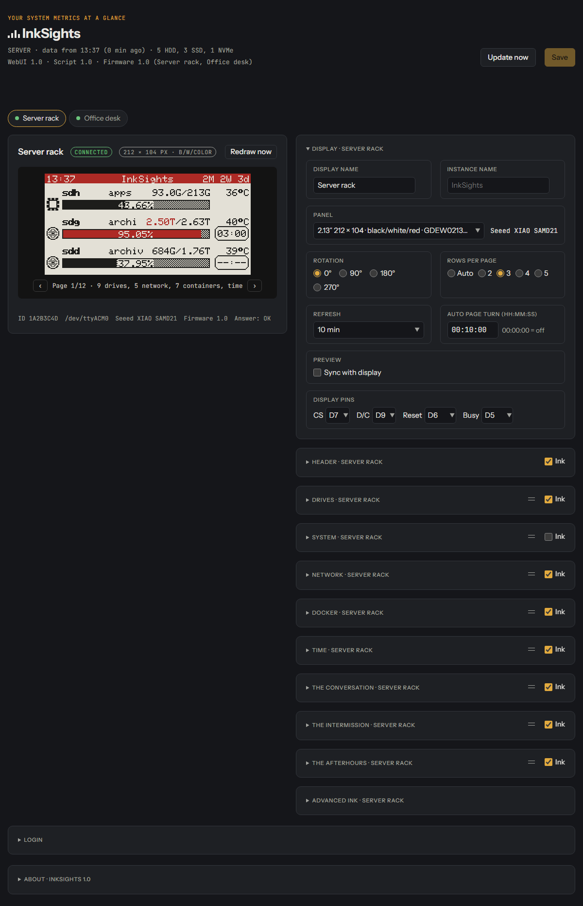 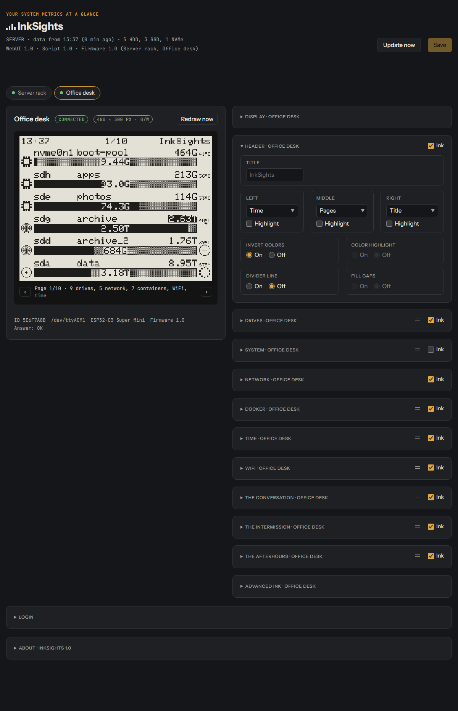

**A new display starts with:**

| Card | Default |
|---|---|
| Pages | all on, in this order: time, system, drives, network, WiFi |
| Header | time · title · uptime, black, no divider line, nothing highlighted |
| Time | weekday and date (`2026-10-26`), time zone UTC, no NTP, no top line |
| System | every row, no ZFS RAM cache, asleep hard disks `STBY` |
| Drives | every drive type, the used capacity in the bar, no temperatures, no spindown timer (ring, counterclockwise when switched on), highlight from 85 % |
| Network | symbols, the percentage in the bar |
| WiFi | symbols, setup access point on after 30 s |
| The Conversation, The Intermission, The Afterhours | header, caption, in the page turn, On cue on, no time window; Beverages Roast |

**Order of the pages:**

- The cards **System**, **Drives**, **Network**, **Time** and **WiFi** have a grip (two horizontal lines left of
  **Ink**).
- Drag a card by it up or down, or click the grip and use the arrow keys.
- The order of these cards is the order of the pages on the display; *Save* applies it.
- **Display**, **Header** and **Advanced Ink** stay in their place.
- The cards **The Conversation**, **The Intermission** and **The Afterhours** have a grip too: a picture that is a
  **Turn candidate** comes in the page turn at the place of its card.

**At the top of the page** (for all displays):

- **Update now** sends fresh values to all displays right away. How often each display gets fresh values is set in
  its card (**Refresh**).
- **New version:** when the page is opened, your browser asks GitHub for the latest InkSights release (at most every
  6 hours; the system does not). When it is newer than the installed version, a line shows it:
  - **Download** opens the release page
  - **Mute** hides it until the page is opened again
  - **Skip version** hides it until a newer version is released
- **Versions:** below the status line the versions of the WebUI, the script and the
  firmware on each controller. The WebUI sets the version; for every part that does not match it a notice says what
  to update, with **Latest release** (the release page on GitHub).

**In each display card:**

- the preview (‹ › turns its pages)
- **Redraw now**: redraws this display within a minute, even if nothing changed and without waiting for the
  3 minutes
- a line with ID, port, board, firmware and the display's last answer

**At the bottom of the page:** the **Login** card (the login of the page, see [Security](#security)) and the
**About** card with the versions, links to the project (GitHub, Releases, README), the license with the libraries
used, and how to support the project.

**Backup** (in the Advanced Ink card of each display):

- **Export** saves the settings of this display as a JSON file, with the InkSights version it was made with:
  - name: `inksights-v<version>-<name>-<chip id>-<date>.json`, e.g.
    `inksights-v1.0-living-room-1a2b3c4d-2026-10-26.json` (the name only when the display has one)
  - WiFi passwords are not in it: they never reach the page
- **Import** reads such a file into this display, also one of another board (e.g. after replacing a board, which
  has a new chip ID):
  1. It is checked first: an InkSights backup of a display, then every setting by the app with the same rules as
     saving. Settings an older backup does not have get their defaults.
  2. A valid file becomes this display's settings on the page as unsaved changes, its display name included.
  3. Check the preview (and the display pins, when it came from another kind of board) and press **Save**.
  4. The WiFi passwords stored on the system stay.

### Display card

The display itself: its names, panel type, rotation, rows per page, refresh, page turn, preview and pins.

| Setting | Options | Notes |
|---|---|---|
| **Display name** | up to 32 characters | Name of the display on this page (card heading). Empty = the title, else "Display <ID>". |
| **Instance name** | up to 32 characters | One setting for the whole page: name in the page header and browser tab (empty = InkSights). |
| **Panel** | the panel types ([Panels](#panels)) | By the name on the flat cable; next to it the board. |
| **Rotation** | 0°, 90°, 180°, 270° | Clockwise. 90° and 270° stand the display upright. |
| **Rows per page** | Auto, 2-5 (6 on the 4.2″) | More rows fit more disks per page. Fewer rows: bigger bar, symbols and timer. |
| **Refresh** | 1, 3, 5, 10, 15, 30 min, 1, 1.5, 2, 3, 4 h; black/white panels also 2, 5, 10, 30 s | How often this display gets fresh values (default 10 min). |
| **Auto page turn** | HH:MM:SS | 00:00:00 = always page 1. |
| **Preview** | tick **Sync with display** | The preview shows what the panel shows (off by default, remembered in this browser). |
| **Display pins** | CS, D/C, Reset, Busy | Only the pins the board allows; Reset and Busy can be None. |

- **Instance name:** shown in every card. The name on the display's start screen is `PRODUCT_NAME` at the top of
  the `.ino`.
- **Sync with display:** the preview follows the rules of the firmware: new values and the next page only when the board
  may redraw (colour panels at most every 3 minutes, fast refresh as often as set), the first data and **Redraw
  now** at once. In between it keeps the old picture, like the panel. Below the preview: `Live`, the page and when
  it was drawn; the page buttons are off then. The board reports which page its panel shows, when it last redrew
  and when the next page is due (over WiFi with every fetch, over USB with every update), and the preview takes
  that over, so it stays in step with the panel.
- **Panel:** the board saves it and restarts with it (over USB with the next update, over WiFi with its next fetch).
  Preview, rows and fast refresh follow it.
- **Rotation** upright: device and used/total in the first line, the pool in its own line.
- **Auto page turn:** the display redraws at most every 3 minutes, so shorter times act like 00:03:00 (not with
  fast refresh).
- **Refresh:**
  - Colour panels redraw at most every 3 minutes and only on changes, so 1 min gets changes there as fast as
    possible.
  - **Seconds** = fast refresh, only black/white panels: the display gets a new frame this often and redraws the
    changed parts without flashing. A full refresh on page turns and every 10 minutes against ghosting.
  - Seconds need the loop: the Docker app runs it; without Docker the tmux line with `-l` (see [3 d)](#d-the-script)).
  - The preview then follows the display just as often (live, the frame it was sent), except while settings are
    changed and not saved.
- **Display pins:** the board stores new pins and restarts once.

### Header card

The top line of the display. Its settings stand in four frames: **Title**; the colours (Invert colors, Color
highlight, Fill gaps); **Divider line**; the places (Left, Middle, Right).

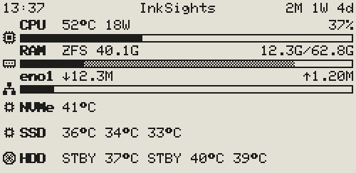

| Setting | Options | Notes |
|---|---|---|
| **Ink** | tick | Shows the top line or not; its settings stay. |
| **Title** | up to 12 characters | Empty = InkSights. |
| **Invert colors** | On, Off | White top line with black text. |
| **Color highlight** | On, Off | Highlighted places in the third colour. |
| **Fill gaps** | On, Off | The whole top line in the third colour (off by default). |
| **Divider line** | On, Off | The line between the top line and the page (off by default). |
| **Left**, **Middle**, **Right** | Title, Pages, Uptime, Time, None | What stands where. Default: Time, Title, Uptime. |
| **Highlight** | tick, for each place | The place in the opposite colours. |

- **Ink** off: the rows get the room of the top line. "NO DATA" still shows it.
- **Invert colors** On: a thin black line below the top line; highlighted places then black with white text.
- **Color highlight:** only with **Invert colors** on a colour panel. The text on it is white, on yellow black.
- **Fill gaps:**
  - only with **Invert colors** and **Color highlight** on a colour panel
  - every place is drawn like a highlighted one, no gaps between them; the **Highlight** ticks then have no effect
  - on black/white it would be the same as switching **Invert colors**
- **Divider line:**
  - with **Invert colors** a thin black line below the top line
  - on the black top line its black edge below the highlighted places (Off: they reach down to its edge)
  - 2 px on the 4.2″
- **Left / Middle / Right:** choosing what already stands in another place swaps the two. None = nothing there.
- **Highlight:** black text on a white box (with **Invert colors**: white on black).
- **Pages** is the page number (e.g. 1/3), only with more than one page. **Uptime** is how long the system has
  been running. **Time** is when the data were sent.
- Left and right stand at the edges, the middle one in the middle as long as there is room. Only the title is cut
  where room is short; the others leave at least 5 of its characters where they can.
- **Uptime** is shown in the three biggest units, e.g. `1W 5d 4h`, `2M 1W 3d` or `1Y 2M 3W`.
  - Where room is short the smallest unit on the right goes first (`2M 1W`, `2M`).
  - Y = year, M = calendar month (counted by the date: from 15 March to 15 April is one month), W = week, d = day,
    h = hour, m = minute.
- **NO DATA** (see [Good to know](#good-to-know)) stands in the place of Pages, else of Uptime, else in a free place.
- The time page has no top line unless the Time card's **Header** is ticked.

### System card

One extra page with the values of the system: CPU, RAM, network and drive temperatures (see
[System page](#system-page)).

| Setting | Options | Notes |
|---|---|---|
| **Ink** | tick | Shows the system page on the display or not; its settings stay. |
| **Components** | CPU, RAM, Network, NVMe, SSD, HDD, any combination | The ticked rows form an extra page; none = no system page. |
| **Network** | Default, the interfaces found | The interface shown; Default = the one with the default route. |
| **ZFS RAM cache** | On, Off | Off: no grey part in the RAM bar, the cache counts as free. |
| **HDD asleep** | STBY, -- | What the HDD row shows for a hard disk that is asleep. |
| **Icons** | On, Off | Symbol at the left of each row. |

- **Components:** the page comes by default after the time page. The number of drives of each type is shown in
  brackets. HDD needs [drive-temp-export](#hdd-temperatures).
- **HDD asleep** is the same setting as **Asleep** in the Drives card.

### Drives card

Pages with one row per drive: symbol, device, pool, used/total and the bar, optionally the temperature and the
spindown timer (see [What a display shows](#what-a-display-shows)).

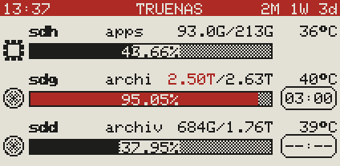 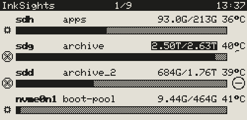

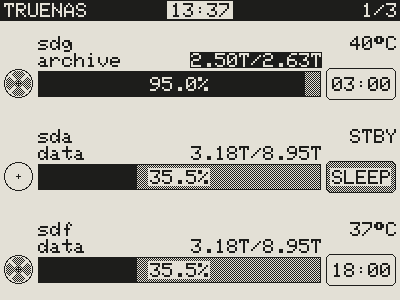

| Setting | Options | Notes |
|---|---|---|
| **Ink** | tick | Shows the drive pages on the display or not; their settings stay. |
| **Drive types** | HDD, SSD, NVMe, any combination | None = no drive pages. |
| **Icons** | On, Off | Symbol left of each bar. |
| **Details in bar** | On, Off | Text inside the bar, only where the bar is high and wide enough. |
| **Details** | Capacity, Percentage | The used capacity (e.g. 3.18T, the default) or the percentage used (e.g. 35%). |
| **Percentage** | 35%, 35.4%, 35.47% | Decimals of the percentage in the bar. |
| **Spindown timer** | On, Off | Hard disks only. Off = no timer, full-width bar. |
| **Timer style** | Ring, Badge | Ring (default): shrinks until spindown. Badge: time left as MM:SS. |
| **Ring direction** | Counterclockwise, Clockwise | For the ring (default counterclockwise). |
| **Temperature** | On, Off | The temperature of each drive (off by default); `--` = unknown. |
| **Asleep** | STBY, -- | What a hard disk that is asleep shows instead of its temperature. |
| **Color highlight** | on/off, from … % used | Bar and used/total are highlighted once a pool is this full. |
| **Order and visibility by** | Pool, UID, Device, Custom | The tick next to each disk shows or hides it on this display. Custom: drag a disk by its grip (two lines at the right), or the arrow keys on the grip. |

- **Drive types:** the number of drives of each type is shown in brackets.
- **Details** Capacity: the top right then shows only the total.
- **Percentage:**
  - cut, not rounded, so 99.99% is never shown as 100%
  - where the bar is too short, fewer decimals are shown
  - more decimals change more often, so the display redraws more often (at most every 3 minutes)
- **Temperature:**
  - at the right of the first text line, above the timer (upright in the pool line)
  - without the timer, used/total moves left to make room
  - hard disks need [drive-temp-export](#hdd-temperatures)
- **Asleep** is the same setting as **HDD asleep** in the System card.
- **Color highlight:** in the third colour on colour panels, inverted on black/white panels.
- **Order:** names like sda can change after a reboot, so Pool, UID and Custom use the serial number (UID); Device
  orders by name.

### Network card

Pages with one row per network interface (by default after the drive pages), as many rows per page as the drive
pages.

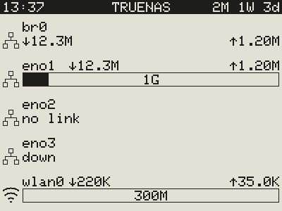 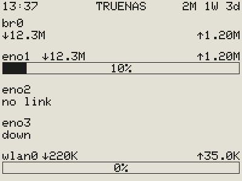

| Setting | Options | Notes |
|---|---|---|
| **Ink** | tick | Shows the network pages or not; their settings stay. |
| **Icons** | On, Off | Linked boxes for a wired interface, the WiFi symbol for a wireless one. |
| **Details in bar** | On, Off | Text inside the bar, only where the bar is high and wide enough. |
| **Details** | Percentage, Link speed | How busy the link is (e.g. 10%) or its speed (e.g. 1G). |
| **Order and visibility by** | Name, Custom | The tick next to each interface shows or hides it. At most 8. Custom: drag an interface by its grip, or the arrow keys on it. |

Each row shows:

- the interface, ↓ download and ↑ upload per second
- a bar with the busier direction of the link speed; none without a link speed (e.g. bridges or WiFi): the values
  then stand below the name
- **down** in the place of the bar when the interface is switched off, **no link** when it has no connection (no
  cable, or WiFi not connected to a network)

With the network pages on but no interface (none found, or all of them unticked) and no other page, the display
shows a page **No interfaces**, like **No drives** for the drive pages.

The same goes for the network row of the system page. Virtual interfaces (Docker, VMs) are left out.

### Time card

A page with the time in big, below it the weekday and the date (each when ticked); by default the first page.

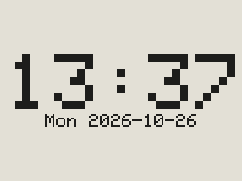 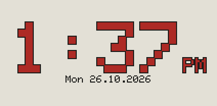

| Setting | Options | Notes |
|---|---|---|
| **Ink** | tick | Shows the time page or not; its settings stay. |
| **Time format** | 24h, 12h | 12h with **AM/PM** On or Off. |
| **Time zone** | about 50 common zones | Only with NTP; summer time included. |
| **Date format** | 26 Oct 2026, 2026-10-26, 10/26/2026, 26.10.2026 | Only with Date. |
| **Show** | Date, Weekday, Header | Below the time the date and the weekday short (`Mon`). |
| **NTP** | On, Off | Where the time comes from (off by default). |
| **NTP server** | e.g. `pool.ntp.org`, `0.pool.ntp.org` … `3.pool.ntp.org`, or any name or IP address | Only with NTP. A click on the field lists the pool servers. |
| **Color highlight** | tick | Colour panels only: the time in the third colour (red or yellow). |
| **Time frame** | tick | Only with **Color highlight**: a black outline around the digits of the time. |
| **Just give me time** | tick | Only the time page on the display (off by default). |

- **Time format** applies to the whole display (the time in the top line, on the time page and in `Closed until`),
  so it stays usable when the time page is off.
- **Time format** with 12h: **AM/PM** On shows `01:37PM` (top line) and `01:37 PM` (time page), Off only `01:37`;
  the hour always has two digits.
- **Header** (off by default): the time page with the top line; off, it has none (the other pages keep theirs). With
  **Just give me time** it decides whether the display has a top line at all.
- **Just give me time:**
  - The cards System, Drives, Network and WiFi are hidden; the Time card's **Ink** is ticked and stays ticked while
    this is on.
  - The top line is shown as the **Header** tick says (off by default). The Header card is shown only while that
    tick is set.
  - Their settings stay, so switching it off brings the header and the pages back as they were.
- **NTP:**
  - Off: the local time of the system, which comes with every update. The board counts on by itself, so the time
    stays right between updates.
  - On (boards with WiFi only): the board sets its clock from the NTP server itself.
- **Color highlight:** weekday and date stay black. **Time frame** keeps a light colour such as yellow easy to read.
- The time in the top line always is the time of the last update from the system.
- A black/white panel redraws the time page every minute (without flashing). A colour panel redraws at most every
  3 minutes, so its clock moves on in steps of 3 minutes.

### WiFi card

Boards with WiFi only: network, password, settings page, host name, setup access point on/off, failover access
point after (s), access point name and password. See [4. WiFi](#4-wifi-optional).

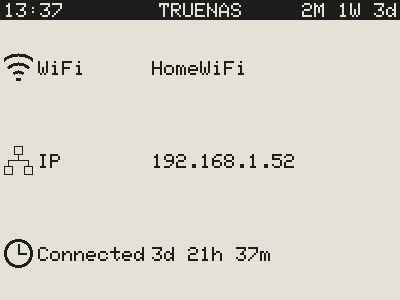

| Setting | Options | Notes |
|---|---|---|
| **Ink** | tick | An extra page (by default the last). The WiFi settings apply either way. |
| **Icons** | On, Off | Symbol at the left of each row. |

The WiFi page has three rows:

- **WiFi:** the network, or the setup access point
- **IP:** the address
- **Connected:** how long the board has been connected without a break

Only boards with WiFi draw it. It is redrawn when one of the rows changes (black/white panels about every minute,
colour panels at most every 3 minutes).

### The Conversation, The Intermission and The Afterhours cards

Each picture has a card named after it, with the screen as this display shows it:

| Card | Picture | Shown |
|---|---|---|
| **The Conversation** | three people at a table | when every page is switched off (Nothing to ink) |
| **The Intermission** | the empty table | when no fresh data come (Check connection) |
| **The Afterhours** | the chairs upside down on the table | in its time window (quiet hours) |

**Ink** says whether the picture is used at all (ticked by default). The settings in the card:

| Setting | Default | What it does |
|---|---|---|
| **Turn candidate** | on | The picture as a page of its own in the page turn, at the place of its card. |
| **Header** | on | The top line above the picture. |
| **Caption** | on | The text below the picture: `Nothing to ink`, `Check connection`, `Closed until 07:00`. |
| **Got the time?** | off | A wall clock showing the time now, in all three pictures at the same place (above the left chair of The Afterhours). |
| **On cue** | on | The Conversation when every page is off, The Intermission when no fresh data come. Not on The Afterhours. |
| **Scheduled**, **From**, **To** | off | In this time window only this picture shows, without page turns. It may go past midnight. |

- **Several cases at once:** a time window comes first, then **On cue**, then the page turn.
- **No overlaps:** the time windows of a display must not overlap; the page does not save them until they don't.
- **The Afterhours:** in its time window the caption says `Closed until` and the end, in the time format of the
  display (`07:00`, `07:00AM`). The time is never left out: where the line is too wide, the time goes to a second line.
- **Got the time?** (off by default, per picture): the wall clock goes on with the time, so the display redraws the
  picture while it is shown: black/white panels every minute without flashing, colour panels as often as their
  **Refresh** says (at least every 3 minutes, each time with the flashing full refresh). Leave it off to spare the
  panel: then the picture stays as it is. The clock takes the time of the last data, counted on by the board.
- **Fixed places:** every picture has its fixed place on a display, the same with or without top line or caption,
  and all captions start on the same line below it. On every 2.13″ the captions are 5x7, on the 4.2″ three times
  that.
- **Every page off and The Conversation not on cue:** the product name with its logo instead of an empty
  panel (see [Good to know](#good-to-know)).
- **On cue** off: The Conversation off shows the logo; The Intermission off lets the display go on with its
  pages (and turn them) without fresh data.
- The board decides the time windows itself with the time of its last data, so a window also begins and ends
  between two updates.

### Advanced Ink card

Framed sections:

- In one row: **Screens** (whether the display shows its start screen after power-up, ticked by default), **Bar
  behaviour** (**Auto collapse**) and **Beverages** (see [Beverages](#beverages)).
- **OTA Update:** new firmware over WiFi, see below.
- **Backup** of the display's settings (see [5. The settings page](#5-the-settings-page)).
- **Remove** (beside Backup, only for a display that is not connected): **Remove display** takes it and its settings off the page
  (with *Save*), e.g. an old display that is no longer plugged in. When it is connected again, it shows up again,
  with the settings of a new display.
- **Frame** (folded, at the end): what the display receives, over USB or WiFi.

| Setting | Off means |
|---|---|
| **Start screen** | After power-up the board draws nothing; the panel keeps its last picture until the first data arrive. |
| **Auto collapse** (Bar behaviour) | On (default): opening a card of this display folds its other cards, so only one is open at a time. |

- **Start screen:** the board stores this setting, so it applies from the next power-up on. A board with WiFi whose
  time page uses NTP also stores the clock: it then shows the time right after power-up, even without the system
  (once NTP has the time).
- **Auto collapse** is remembered in this browser (not in the backup), no need to save.

**OTA Update** (boards with WiFi that fetch their data over WiFi):

- **OTA** On / Off: Off = no firmware updates of this display from the page (saved with *Save*; with the login on,
  only someone with the login can switch it on again). On by default.
- Right of **Update firmware**: **Firmware up to date.**, or **New firmware available!** in green. Only then a line
  below says why it cannot be flashed from here, if so (e.g. `Seeed XIAO SAMD21 has no WiFi: update it over USB.`).
- OTA only means updates over WiFi. Flashing over USB (see [2.](#2-upload-the-firmware)) is not affected by it.
- **Update firmware** flashes the firmware the settings page brings with it, the same version as the page. The board
  fetches it within 30 seconds, checks it, flashes it and restarts; when anything goes wrong it keeps the old one.
  The button only works when the firmware fits this board and the board is on the WiFi.
- **Manual update:** **Choose file** takes a firmware file from your computer, the release file
  (`inksights-v<version>-<board>-factory.bin`) or the `firmware.bin` of a build. The page checks it first: an
  ESP32 firmware for this chip and this board, small enough for its firmware slot. The result stands below the buttons:
  **Firmware valid.** in green, then **Upload** flashes it.
- While it runs, the frame shows `Waiting for the board`, then `Loading firmware … %`, then `Updated` or `Update
  failed` with the reason. The board checks size and checksum before it switches; the old firmware stays when the
  download breaks off.
- The Docker image carries the firmware of every board with WiFi (built with the image). Running the settings page
  from a folder of the repository it carries none: then only **Manual update** works.
- With `INKSIGHTS_OTA=off` in the Docker settings the frame only says **Switched off on the server.** and nothing can be
  flashed from the page (see [Security](#security)).

### Beverages

In the [Advanced Ink card](#advanced-ink-card), frame **Beverages**: what stands on the table of The Conversation,
The Intermission and The Afterhours.

| Choice | On the table |
|---|---|
| **House Wine** | the wine bottle and the glass |
| **Roast** (default) | a coffee cup |
| **Tabula Rasa** | nothing: no bottle, no glass, no cup |

A display often stands at work, in a shared room, in a school, or in front of people who do not drink, who stopped
drinking, or who simply do not want to be reminded of it. InkSights respects that and takes it into account from
the start: the pictures come with a coffee cup by default, show the bottle only when you choose **House Wine**, and
**Tabula Rasa** leaves the table empty.

**Roast:** the cup stands at the right edge of the table, in The Afterhours on the table between the chairs and
without steam (a cold cup left at closing time). It is the same cup in every picture, in the third colour on colour
panels, black on black/white panels; on the 4.2″ in 2 x 2 pixels. The choice applies per display, to all three
pictures, also to their previews in the cards.

### Simulator

`simulator/simulator.html` opens in any browser straight from the folder. It is the same settings page with
simulated data. Nothing is sent anywhere, except to a board on USB.

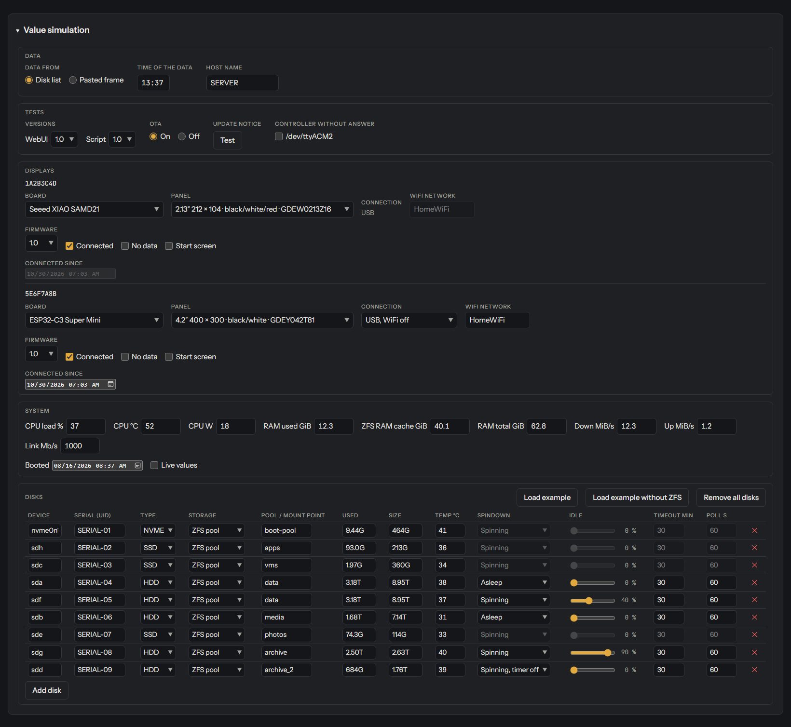

The **Value simulation** card below the displays has these frames:

- **Data:** disk list or a frame pasted from a dry run, the time of the data, the host name.
- **Tests:**
  - **Versions** sets the version of the WebUI and of the script. Below the status line the page then shows which
    versions run, and a notice for every one that does not match the WebUI, with **Latest release** (the release
    page on GitHub).
  - **OTA** Off: as if `INKSIGHTS_OTA=off` were set in the Docker settings (firmware updates switched off on the
    server).
  - **Update notice · Test** shows the line about a new version (one version after the installed one, or after a
    skipped one).
  - **Controller without answer** adds a port that does not answer (e.g. old firmware).
- **Displays**, per display:
  - board, panel, connection and WiFi network
  - **Firmware:** the version of its firmware
  - **Connected** off: what it draws when it gets no fresh data any more (NO DATA, Check connection)
  - **No data** at a connected one: the "Nothing to ink" screen (nothing to show)
  - **Start screen:** what it shows after power-up until the first data arrive
  - **Connected since:** for the WiFi page
- **System:** the system values and when the server started. **Live values** = a running system: displays with a
  refresh in seconds show changing system values, drive temperatures and counting-down spindown timers, as often as
  they refresh.
- **Disks:** the drives (with or without ZFS), each with storage, usage, temperature (column **Temp °C**) and spindown
  state.
- **Containers:** Docker containers for the Docker pages, each with its name, its state (running, error, stopped) and
  whether an update is out; **Add container**, **Load example**.

Also in the simulator:

- The simulated interfaces cover every case: wired, no cable, switched off, a bridge and WiFi.
- **Docker** card and pages (a preview of what is planned, not on the real settings page yet): one row per container
  with its state and "update" when a newer image is out; **Show** all, errors, updates or both; **Color highlight**
  and **Highlight** (in a box) for errors and updates; **Order and visibility by** State, Name or Custom; a grip like
  the other page cards.

  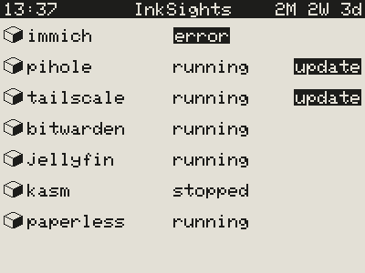 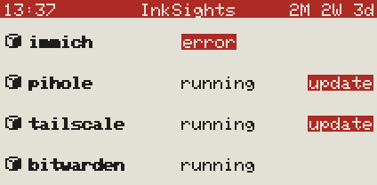 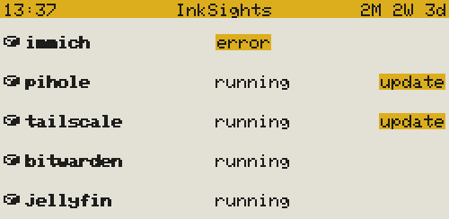
- The Value simulation card folds (the triangle next to its heading).
- The **USB** card at the bottom is the [USB setup](#usb-setup), plus **Send to display**: it sends what a simulated
  display gets to the real board, so the display shows it right away (without "NO DATA" later, as the simulated time
  does not move). Chrome or Edge only.

## Update

```
cd /mnt/apps/docker/stacks/inksights && sudo docker compose pull && sudo docker compose up -d   # settings page and script
```

1. Reload the settings page in the browser (Ctrl+F5).
2. Script without Docker: `git pull` in `/home/truenas_admin/inksights` (with curl / ZIP: get the files again as in
   3 a)), then `sudo tmux kill-session -t inksights` and start it again with the line from
   [3 d)](#d-the-script) (with cron there is nothing to do).
3. New firmware: upload it as in [2.](#2-upload-the-firmware). The settings stay (on the SAMD21 the system sends
   pins and panel type again). Boards with WiFi will also take it over WiFi from the
   [Advanced Ink card](#advanced-ink-card).

Good to know:

- The settings page sets the version: script and firmware belong to the same one. In the Docker app the script
  always has the version of the settings page.
- With a fixed version in the `image:` lines, enter the new one there first.
- With the TrueNAS app list, redeploy the app so it fetches the new image.
- If `server/docker/docker-compose.yaml` changed, take the changes over into your stack and deploy it again.

## System page

One extra page (by default after the time page) with the ticked rows; sizes like a drive page with as many rows:

| Row | Left | Middle | Right | Bar |
|---|---|---|---|---|
| CPU | `CPU` | temperature, power | load | load |
| RAM | `RAM` | ZFS RAM cache (shown as `ZFS`) | used by programs / total | black = programs, grey = ZFS RAM cache, light = free |
| Network | interface | ↓ download per second | ↑ upload per second | the busier direction of the link speed |
| NVMe | `NVMe` | temperature of each NVMe drive | - | - |
| SSD | `SSD` | temperature of each SATA / SAS SSD | - | - |
| HDD | `HDD` | temperature of each hard disk, `--` or `STBY` when asleep | - | - |

- **Icons:** a processor for CPU, a memory module for RAM, linked boxes for the network, the chip for NVMe and SSD,
  the disc for HDD (light when all hard disks are asleep, grey as soon as one runs).
- **Temperatures** stand after the name (upright: below it), at most six per row. A temperature row without such
  drives is left out, and the other rows get bigger.
- **Network row:**
  - without a link speed (e.g. bridges) its values stand below the name instead of a bar
  - "down" / "no link" instead of the bar when the interface is off or has no connection
  - a wireless interface gets the WiFi symbol instead of the linked boxes

**Where the values come from:** `/proc` and `/sys`, never from the hard disks.

- **RAM:** ZFS uses almost all free memory as cache and gives it back when programs need it, so it is shown apart
  (can be switched off per display). Systems without ZFS simply show no cache.
- **Power:** what the processor itself uses (Intel, newer AMD), not the whole server. Not available in virtual
  machines.
- **CPU temperature:** Intel (`coretemp`), AMD (`k10temp`, `zenpower`) or the CPU sensor of ARM boards.
- **NVMe temperature:** read from the NVMe driver at most every 30 seconds (a tiny request to the NVMe drive; no
  moving parts, it does not wake anything).
- **SSD temperature:**
  - only when a display shows the SSD row, at most every 30 seconds, with `smartctl` (TrueNAS has it; without it
    the row stays empty)
  - only drives the system reports as SSD are asked, with `-n standby` (a drive that says it is asleep is not asked)
  - hard disks are never asked
- **HDD temperature:** see below.
- **Load, power and network** are averages since the previous reading: over seconds with fast refresh, otherwise
  since the last update. Unknown values show `--` or are left out.
- The preview on the settings page shows the values of the last full update.

### HDD temperatures

InkSights never asks a hard disk anything itself, so it does not wake one. It takes hard disk temperatures from
[drive-temp-export](https://github.com/Gittegatt/drive-temp-export):

- a separate tool that asks only spinning hard disks (`smartctl -n standby`: a sleeping disk is not asked) and
  writes a status file
- when it runs on the system, InkSights reads that file: `/run/system-metrics/output/disk-temp/status`
  (another place: set `DRIVE_TEMP_STATUS` for the script)

What the display shows:

- a disk the tool reports as active: its temperature
- one that is asleep (for the tool or for the spindown timer): `--`, or `STBY` with **Asleep** / **HDD asleep** set
  to STBY
- a status file older than 5 minutes counts as missing: then the HDD row of the system page is left out and the
  drive pages show `--` for hard disks

SSD and NVMe temperatures do not need it.

## Good to know

### Does not wake disks

- The script only reads ZFS data from memory, `/proc`, `/sys`, filesystem usage (`df`) and the status file of the
  spindown timer.
- It never queries the hard disks itself; SSDs only for their temperature.
- Hard disk temperatures come from the status file of drive-temp-export (see [HDD temperatures](#hdd-temperatures)).

### Usage = pool usage

ZFS spreads data over all disks of a pool, so all disks of a pool show the same bar. The same goes for one RAID or
one btrfs filesystem over several disks.

### Disks outside ZFS

Disks outside ZFS show the biggest filesystem mounted on them (or on their partitions, RAID or LVM), named after its
mount point (`/` = `root`). A disk with nothing mounted shows its size and "not mounted" instead of a bar.

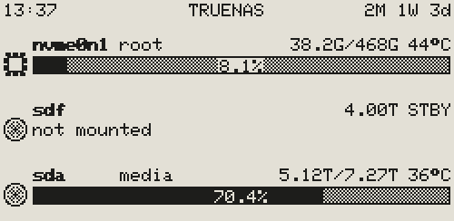

### Spares the panel

- A display does not redraw when nothing changed, and never more often than every 3 minutes.
- With several pages it turns one page per redraw.
- Only "Redraw now" skips both.
- A **Refresh** of 1 min gets changes there as fast as possible. With a refresh in seconds (black/white panels) it
  redraws as often as set.

### The Conversation

With every page of a display switched off (no system, drive, network, time or WiFi page), it shows **Nothing to
ink**, so it never looks broken.

The pictures of this part without the top line (the default), three per screen: **House Wine** (the bottle and the
glass, no caption), **Roast** (a coffee cup, the default of [Beverages](#beverages), with its **Caption**) and
**Tabula Rasa** (nothing on the table) with its **Caption** and **Got the time?** (a wall clock):

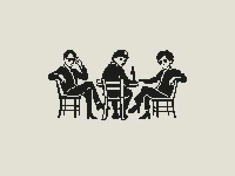  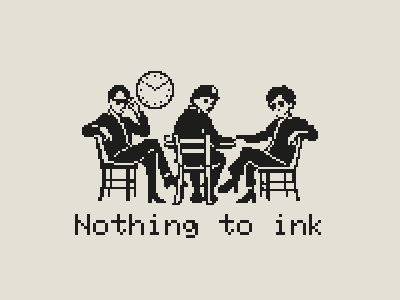

### The Intermission

When a display gets no fresh data for a while, it shows **Check connection** below a picture of the empty table, and
**NO DATA** in the top line (with its **Header** ticked). E-paper keeps its picture even without power, so a display
that gets nothing any more would look the same as one that works.

- **When:** after twice its **Refresh** plus 2 minutes without fresh data (at least 10 minutes; e.g. 22 minutes at
  10 minutes, 8 hours 2 minutes at 4 hours).
- **NO DATA** stands where the page number or the uptime stands. The display stops turning pages.
- The time at the top right stays: that is when the last data came.
- With the next fresh data the pages come back.
- Reasons: the board is unplugged or the system is off, the script or the settings page does not run, or a WiFi
  board lost its WiFi.

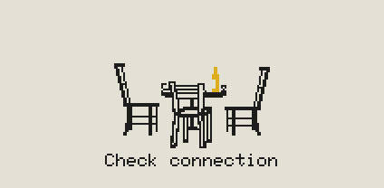 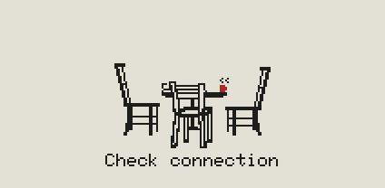 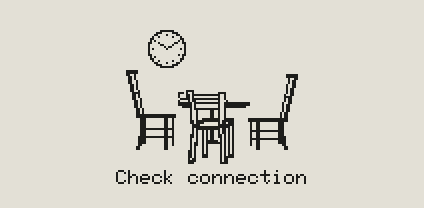

### The Afterhours

Tick **Scheduled** in the card **The Afterhours** and set **From** and **To** (e.g. 23:00 to 07:00). In that time
the display shows only this picture, the chairs up on the table, with **Closed until 07:00** below it (in the time
format of the display, with 12h `Closed until 07:00AM` as in the pictures), and spares the panel: new data do not
redraw it. With **Roast** the cup stands between the chairs, without steam: a cold cup left at closing time.

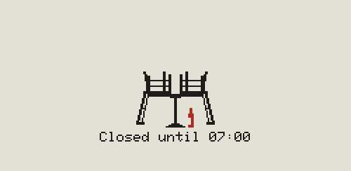 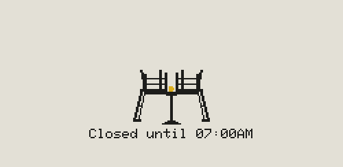 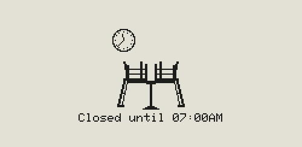

### InkSights

With every page switched off and **The Conversation** with **On cue** off, the display shows the product name with
its logo instead:


### Refresh in seconds and minutes

A display on seconds gets fresh system values and timers that often. Its drives and pools come from the full
updates, at least once a minute while such a display is there.

## Security

- **The settings page is isolated.** Its container has no USB access and no rights on the system; it only shares
  the data folder with the script.
- **The script checks its settings strictly** and never executes any of it.
- **The settings page has no login at first.** Everyone in your network who opens it can change the display
  settings and update the firmware of the boards with WiFi.
- **Login card** (at the bottom of the page): tick **Login**, enter a new password twice, **Switch on**. From then
  on the browser asks for the user name `inksights` (or the one set with `INKSIGHTS_USER`) and that password. While it
  is on: **Change password** with the current one, or untick **Login** and **Switch off** with the current one.
  The data folder keeps it in `login.json` (only a salted hash, never the password itself).
- **Or in the Docker settings:** in `docker-compose.yaml` remove the `#` in front of `- INKSIGHTS_PASSWORD=` and
  enter a password, then `sudo docker compose up -d`: the login is on with that password. The newer change wins:
  change `INKSIGHTS_PASSWORD` afterwards and what the Login card set is dropped at the next start; a change in the
  Login card counts until `INKSIGHTS_PASSWORD` changes again.
- **With the login** the page only takes ESP32 firmware files, and a board only takes one that fits. A wrong
  password costs a second, so guessing is slow.
- **Without a login, always:** what the boards need, their frame and their firmware update. A board's own WiFi page
  (setup access point) has no login either.
- **Forgot the password?** Delete `login.json` in the data folder and restart the app
  (`sudo docker restart inksights`): the login is off again (or back to `INKSIGHTS_PASSWORD`, if that is set). Or
  set a new `INKSIGHTS_PASSWORD` as above. Only someone with access to the server can do this.
- **The login is sent unencrypted** (plain http, like most pages in a home network). Use it only in your own
  network.
- **Keep the page in your own network.** Do not open its port on your router (no port forwarding), and put guests
  in a guest WiFi if your router has one. The port is set in `ports:` in the Docker settings
  ([3 c)](#c-start-the-settings-page-and-the-script-as-a-docker-app)).
- **The script container has full access to the system** (`privileged`, the processes of the system): it needs
  the USB ports, drives, pools and network interfaces, as root, like a script started on the system. It has no
  port and no network of its own, so it cannot be reached from outside. The settings page runs in its own
  container without these rights: whoever gets into the page does not get into the system.
- **Firmware updates can be switched off:** per display with **OTA** Off in its Advanced Ink card, or for all of them
  with `- INKSIGHTS_OTA=off` in `docker-compose.yaml`, then `sudo docker compose up -d`. The page then flashes nothing at all, and it cannot be switched on again from the
  page, only in the Docker settings.
- **WiFi passwords** stay in the settings file of the data folder (readable only for the app and root), are never
  shown on the page again and reach a board only over USB (see [4. WiFi](#4-wifi-optional)).
- **Backup files hold no WiFi passwords.** They are plain text and easily end up in a download folder, a cloud or a
  mail, so the export leaves the passwords out and the import never takes any from a file.

## Troubleshooting

| Problem | What to do |
|---|---|
| Something does not work as expected | Look at the log: `sudo tail -n 50 /var/run/inksights/inksights.log` |
| Picture shifted, cut off or just noise | The panel type does not match: choose the next type under **Panel** and save; the board restarts with it. |
| Display does not appear on the settings page | Is the script running (`sudo docker logs --tail 20 inksights-script`)? Is the board plugged in? A board with an old firmware shows up as "No answer with chip ID": upload the firmware again. |
| **NO DATA** and "Check connection" | The display got no fresh data for a while. Is the script running (`sudo docker ps`, `sudo docker logs --tail 20 inksights-script`)? Is the board plugged in? WiFi boards: is the WiFi there, does the settings page run (`sudo docker ps`)? See [The Intermission](#the-intermission) in Good to know. |
| `--:--` (badge) or a circle with a dash (ring) | The spindown timer is not running, or its status file is older than two rounds. The symbol then shows the last known state. |
| Setup page of the board does not open | Wait up to a minute after power-up, or open **http://192.168.4.1** yourself while connected to **InkSights**. |
| Port not found when uploading | SAMD21: press RESET twice quickly, or the 1200 baud touch (see [2.](#2-upload-the-firmware)). ESP32: hold BOOT while plugging in. |
| XIAO ESP32-C3 does not start with the display connected | Choose another pin than D9 for D/C on the settings page. |
| Hard disks wake up | Data folder and Docker data must be on an SSD (see 3 b). |
| Settings page asks for a login | User `inksights` (or the one set with `INKSIGHTS_USER`) and the password set in the Login card or with `INKSIGHTS_PASSWORD`. Forgotten: see [Security](#security). |
| Settings page does not start, or *Save* fails | Look at `sudo docker logs --tail 20 inksights`. *Permission denied*: the app user cannot use the data folder, see "Check the app user" in 3 b). |
| Log says `Data folder … not found`, settings page shows old data | Script without Docker: it was started with another folder after `-d` than the data folder of the app. Fix the line in 3 d) and start it again. |
| `inksights-script` stops with *cannot reach the system* | The container needs `privileged: true` and `pid: host` (as in `docker-compose.yaml`). |
| `inksights-script` stops with *the system has no /bin/bash* | The script needs bash on the system (TrueNAS, Debian, Proxmox and Unraid have it). |

## Protocol (for the curious)

<details>
<summary><b>The lines between the script and a board</b></summary>

```
PING                                   -> PONG InkSights id=1A2B3C4D size=212x104 colors=3 rows=4 pins=7,9,6,5 panel=1 board=xiao-samd21 wifi=0 fw=1.0
#BEGIN
H|HDD|14:30|5|85|0|600
D|sda|data|3.18T|8.95T|35|3|10|A
#END                                   -> OK disks=1 page=1/1 refresh=now shown=1 drawn=0 turn=-1
```

**Answer:** `page=` the page after this frame, `refresh=` whether it redraws now, later (at most every 3 minutes) or
not at all (nothing changed); `shown=` the page on the panel (0 = start screen), `drawn=` seconds since the last
redraw, `turn=` seconds until the next page turn (-1 = none): for **Sync with display**. A WiFi board sends the answer and
the panel status with its next fetch.

**PONG:**

- `colors=3` colour panel, `colors=2` black/white
- `panel=` the panel type: 1-5 in the order of the [Panels](#panels) table, 6-8 the yellow versions of 1-3
- a WiFi board also reports `net=sta|ap|off`, `ip=…` and its stored WiFi settings without the passwords: `ssid=`,
  `host=`, `server=`, `apssid=` (hex encoded, only when set), `ap=1|0`, `apdelay=`, `pass=1|0` (= a password is
  stored)
- a panel with fast refresh adds `fast=1`

| Line | Fields | Notes |
|---|---|---|
| `H` | title, time, rows, highlight from %, quarter turns, page turn in seconds [, the 24 optional fields below] | The settings of the screen. |
| `A` | per picture C I A one hex digit (1 caption, 2 header, 4 in the page turn, 8 scheduled), Beverages 0 House Wine / 1 Tabula Rasa / 2 Roast, card order (`SDNTW` and `CIA`), time windows `HHMM-HHMM,HHMM-HHMM,HHMM-HHMM` [, Got the time? per picture C I A `1`/`0`, the Refresh in seconds; missing = none] | The pictures; only when they differ from the defaults (`011`, 1, page order + `CIA`, `1800-1900,1200-1300,2300-0700`; a new display has Roast, so it gets this line). |
| `D` | device, pool, used, total, percent, filled boxes, total boxes, state, seconds until spindown, timeout seconds [, °C] | One per drive. |
| `S` | rows, CPU %, CPU °C, CPU W, RAM used MiB, ZFS cache MiB, RAM total MiB, interface, down KiB/s, up KiB/s, link Mb/s, NVMe °C,…, SSD °C,… | Only with the system page. |
| `C` | local date and time `YYYYMMDDHHMMSS`, date 1/0, weekday 1/0, date format 0-3, NTP 1/0, NTP server, POSIX time zone [, time in the third colour 1/0, black outline 1/0] | Only with the time page. |
| `T` | HDD °C,… | After the `S` line, only with the HDD row and drive-temp-export running. |
| `N` | interface, down KiB/s, up KiB/s, link Mb/s, wireless 1/0, state | Only with the network pages, one per interface, at most 8. |
| `P` | CS, D/C, Reset, Busy [, panel] | Only when pins or the panel type are set on the settings page. |
| `W` | network, password, host, settings page, access point 1/0, access point name, access point password, access point after (s) | USB only, boards with WiFi; texts hex encoded. |
| `R` | - | Only after "Redraw now". |
| `U` | size, MD5 | WiFi only: a firmware update waits. The board fetches it from the settings page, checks it and restarts with it; the result goes with its next fetch. |

**Optional fields of the `H` line,** in this order (`H` itself is field 1):

| # | Field | Values |
|---|---|---|
| 8 | timer | 0 badge / 1 ring |
| 9 | ring direction | 0 clockwise / 1 counterclockwise |
| 10 | symbols | 1 on / 0 off |
| 11 | details in the bar | 0 none / 1 percentage / 2 used capacity |
| 12 | fast refresh | seconds, 0 = off |
| 13 | uptime | minutes after the full calendar months, -1 = none |
| 14 | uptime months | full calendar months |
| 15 | WiFi page | 0 off / 1 with symbols / 2 without |
| 16 | no data after | seconds without fresh data before "NO DATA", 0 = never |
| 17 | header layout | left, middle, right as three letters: `T` title, `P` page number, `U` uptime, `C` time, `-` nothing; lower case = highlighted (default `TCP`, `---` = no top line) |
| 18 | drive pages | 1 on / 0 off (with no system or network page either: "Nothing to ink") |
| 19 | network details | 0 none / 1 percentage / 2 link speed |
| 20 | network symbols | 1 on / 0 off |
| 21 | drive temperatures | 1 on / 0 off (the D lines then carry them) |
| 22 | asleep | hard disks asleep 1 `STBY` / 0 `--` |
| 23 | header inverted | 1 white / 0 black |
| 24 | header colour | inverted top line: highlighted places 1 in the third colour / 0 black |
| 25 | time format | 0 24 hours / 1 12 hours with AM/PM / 2 12 hours without |
| 26 | screens | shown when needed: 1 start screen + 2 Nothing to ink + 4 Check connection (default 7; 2 and 4 only with the Ink of their picture on) |
| 27 | divider line | 1 below the top line / 0 none (default 1) |
| 28 | page order | `S` system, `D` drives, `N` network, `T` time, `W` WiFi, each once (default `SDNTW`) |
| 29 | time page header | 1 with the top line / 0 without (default 0) |
| 30 | header fill | 1 the top line filled in the third colour / 0 (default 0, sent only with header inverted and header colour) |
| 31 | network pages | 1 on / 0 off (on without interfaces: the page "No interfaces") |

**Notes on the other lines:**

- `D`:
  - °C only with drive temperatures on; -1 = unknown, -2 = asleep (older firmware shows `--`)
  - the boxes are no longer drawn
  - seconds until spindown -1 = timer not running
  - state: `A` spinning, `S` asleep, `N` SSD/NVMe, `?` unknown, `-` timer off (HDDs only)
  - percent may have one or two decimals (cut) for the text in the bar; -1 = no pool and nothing mounted (total =
    the size of the disk, or `-`)
- `S`: rows `C` CPU, `R` RAM, `N` network, `V` NVMe, `S` SSD, `H` HDD (temperatures in the `T` line), `I` = symbols
  on, `W` = the interface is wireless, `D` / `L` = it is down / has no link. -1 = unknown, `-` = none; at most six
  temperatures each.
- `C`: without NTP the board counts on from the date and time; server and zone `-` without NTP. The outline only
  with the colour; both only on colour panels.
- `T`: -1 = unknown, -2 = asleep, at most six.
- `N`: state `U` up, `L` no link, `D` down.
- `P`: pin numbers of the board (D numbers on the SAMD21, GPIO numbers on the ESP32 boards). New values → store and
  restart.
- `R`: redraw right away, even without changes and before the 3 minutes are up.

WiFi boards fetch the same frame with `GET /api/frame?id=…&size=…` from the settings page; their answer goes along
with the next request.

</details>

## License

Copyright 2026 Gittegatt

InkSights is free software: you can redistribute it and/or modify it under the terms of the
[GNU General Public License version 3](https://www.gnu.org/licenses/gpl-3.0.html) (GPL-3.0) as published by
the Free Software Foundation. The full text is in [LICENSE](LICENSE).

InkSights is distributed in the hope that it will be useful, but WITHOUT ANY WARRANTY; without even the implied
warranty of MERCHANTABILITY or FITNESS FOR A PARTICULAR PURPOSE. See the GNU General Public License for more
details.

The firmware uses these libraries. They remain subject to their respective licenses:

- [GxEPD2](https://github.com/ZinggJM/GxEPD2) (GPL-3.0)
- [Adafruit GFX Library](https://github.com/adafruit/Adafruit-GFX-Library) (BSD), including its 5x7 font, which
  the settings page uses as well; its license is in [licenses/adafruit-gfx-bsd.txt](licenses/adafruit-gfx-bsd.txt)
- [Adafruit BusIO](https://github.com/adafruit/Adafruit_BusIO) (MIT)
- on the SAMD21, [FlashStorage](https://github.com/cmaglie/FlashStorage) (LGPL-2.1)

## AI Notice

AI-assisted coding tools were used during the development of this project.

Use of this source code, including for AI or machine-learning training, fine-tuning, dataset creation, and model
improvement, is subject to the terms of the GNU General Public License version 3.

This notice does not impose any additional restrictions, does not apply to third-party material beyond its
respective terms, and does not override applicable statutory rights or exceptions.

## Support the project

If you enjoy the project and would like to support its development, a small contribution is always appreciated.

[Star on GitHub](https://github.com/Gittegatt/InkSights)

[Support on Ko-fi](https://ko-fi.com/gittegatt)

[Support on PayPal](https://paypal.me/gittegatt)
