# The settings page

Every card of the settings page and its settings, in the order of the page. How to open the page, the
defaults of a new display and the order of the pages: [README, 5. The settings page](../README.md#5-the-settings-page).

**Contents**

- [Words used](#words-used)
- [Display card](#display-card)
- [Header card](#header-card)
- [Time card](#time-card)
- [System card](#system-card)
- [Drives card](#drives-card)
- [Network card](#network-card)
- [Docker card](#docker-card)
- [WiFi card](#wifi-card)
- [The Conversation, The Intermission and The Afterhours cards](#the-conversation-the-intermission-and-the-afterhours-cards)
- [Advanced Ink card](#advanced-ink-card)
- [Beverages](#beverages)
- [Simulator](#simulator)
- [System page](#system-page)

## Words used

The page keeps its labels short. What they mean:

| Word | Meaning |
|---|---|
| **Ink** | The tick at the top right of a card: its page (the top line, the picture) is on the display or not. Its settings stay either way. |
| **Top line** | The header line at the top of the display (Header card). |
| **Third colour** | Red or yellow, on colour panels. Black/white panels draw it black. |
| **Highlight** | Text in the opposite colours: black on white, or white on black, in a box. |
| **Color highlight** | The same in the third colour (colour panels only). |
| **Refresh** | How often a display gets fresh values from the system (Display card). |
| **Fast refresh** | A Refresh in seconds: black/white panels only, redrawn without flashing. |
| **Auto page turn** | How long a page stays on the display before the next one comes. |
| **Update now** | Fresh values to every display right away (top of the page). |
| **Redraw now** | Redraws one display within a minute, even if nothing changed (display card). |
| **Grip** | The two lines left of **Ink** or at the right of a list row: drag them to change the order. |
| **On cue** | Only when it is needed: The Conversation when every page is off, The Intermission when no fresh data come, the Docker page while a container is shown. |
| **Turn candidate** | A picture that also comes as a page of its own in the page turn. |
| **Sync with display** | The preview shows exactly what the panel shows right now. |

## Display card

The display itself: its names, panel type, rotation, rows per page, refresh, page turn, preview and pins.

| Setting | Options | Notes |
|---|---|---|
| **Display name** | up to 32 characters | Name of the display on this page (card heading). Empty = the title, else "Display <ID>". |
| **Instance name** | up to 32 characters | One setting for the whole page: name in the page header and browser tab (empty = InkSights). |
| **Panel** | the panel types ([Panels](../README.md#panels)) | By the name on the flat cable; next to it the board. |
| **Rotation** | 0°, 90°, 180°, 270° | Clockwise. 90° and 270° stand the display upright. |
| **Rows per page** | Auto, 2-5 (6 on the 4.2″) | More rows fit more disks per page. Fewer rows: bigger bar, symbols and timer. |
| **Refresh** | 1, 3, 5, 10, 15, 30 min, 1, 1.5, 2, 3, 4 h; black/white panels also 2, 5, 10, 30 s | How often this display gets fresh values (default 10 min). |
| **Auto page turn** | HH:MM:SS | 00:00:00 = always page 1. |
| **Preview** | tick **Sync with display** | The preview shows what the panel shows (off by default, remembered in this browser). |
| **Display pins** | CS, D/C, Reset, Busy | Only the pins the board allows; Reset and Busy can be None. |

- **Instance name:** shown in every card. The name on the display's start screen is `PRODUCT_NAME` at the top of
  the `.ino`.
- **Sync with display:** the preview follows the rules of the firmware: new values and the next page only when the board
  may redraw (colour panels at most every 3 minutes, fast refresh as often as set), the first data and **Redraw
  now** at once. In between it keeps the old picture, like the panel. Below the preview: `Live`, the page and when
  it was drawn; the page buttons are off then. The board reports which page its panel shows, when it last redrew
  and when the next page is due (over WiFi with every fetch, over USB with every update), and the preview takes
  that over, so it stays in step with the panel.
- **Panel:** the board saves it and restarts with it (over USB with the next update, over WiFi with its next fetch).
  Preview, rows and fast refresh follow it.
- **Rotation** upright: device and used/total in the first line, the pool in its own line.
- **Auto page turn:** the display redraws at most every 3 minutes, so shorter times act like 00:03:00 (not with
  fast refresh).
- **Refresh:**
  - Colour panels redraw at most every 3 minutes and only on changes, so 1 min gets changes there as fast as
    possible.
  - **Seconds** = fast refresh, only black/white panels: the display gets a new frame this often and redraws the
    changed parts without flashing. A full refresh on page turns and every 10 minutes against ghosting.
  - Seconds need the loop: the Docker app runs it; without Docker the tmux line with `-l` (see [3 d)](../README.md#d-the-script)).
  - The preview then follows the display just as often (live, the frame it was sent), except while settings are
    changed and not saved.
- **Display pins:** the board stores new pins and restarts once.

## Header card

The top line of the display. Its settings stand in four frames: **Title**; the colours (Invert colors, Color
highlight, Fill gaps); **Divider line**; the places (Left, Middle, Right).

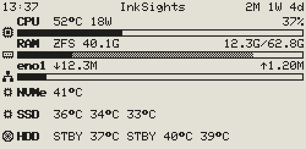

| Setting | Options | Notes |
|---|---|---|
| **Ink** | tick | Shows the top line or not; its settings stay. |
| **Title** | up to 12 characters | Empty = InkSights. |
| **Invert colors** | On, Off | White top line with black text. |
| **Color highlight** | On, Off | Highlighted places in the third colour. |
| **Fill gaps** | On, Off | The whole top line in the third colour (off by default). |
| **Divider line** | On, Off | The line between the top line and the page (off by default). |
| **Left**, **Middle**, **Right** | Title, Pages, Uptime, Time, None | What stands where. Default: Time, Title, Uptime. |
| **Highlight** | tick, for each place | The place in the opposite colours. |

- **Ink** off: the rows get the room of the top line. "NO DATA" still shows it.
- **Invert colors** On: a thin black line below the top line; highlighted places then black with white text.
- **Color highlight:** only with **Invert colors** on a colour panel. The text on it is white, on yellow black.
- **Fill gaps:**
  - only with **Invert colors** and **Color highlight** on a colour panel
  - every place is drawn like a highlighted one, no gaps between them; the **Highlight** ticks then have no effect
  - on black/white it would be the same as switching **Invert colors**
- **Divider line:**
  - with **Invert colors** a thin black line below the top line
  - on the black top line its black edge below the highlighted places (Off: they reach down to its edge)
  - 2 px on the 4.2″
- **Left / Middle / Right:** choosing what already stands in another place swaps the two. None = nothing there.
- **Highlight:** black text on a white box (with **Invert colors**: white on black).
- **Pages** is the page number (e.g. 1/3), only with more than one page. **Uptime** is how long the system has
  been running. **Time** is when the data were sent.
- Left and right stand at the edges, the middle one in the middle as long as there is room. Only the title is cut
  where room is short; the others leave at least 5 of its characters where they can.
- **Uptime** is shown in the three biggest units, e.g. `1W 5d 4h`, `2M 1W 3d` or `1Y 2M 3W`.
  - Where room is short the smallest unit on the right goes first (`2M 1W`, `2M`).
  - Y = year, M = calendar month (counted by the date: from 15 March to 15 April is one month), W = week, d = day,
    h = hour, m = minute.
- **NO DATA** (see [Good to know](../README.md#good-to-know)) stands in the place of Pages, else of Uptime, else in a free place.
- The time page has no top line unless the Time card's **Header** is ticked.

## Time card

A page with the time in big, below it the weekday and the date (each when ticked); by default the first page.

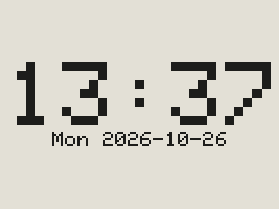 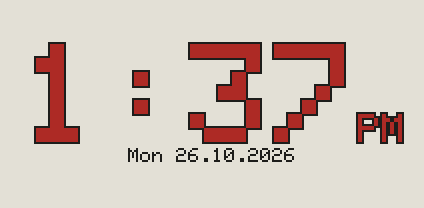

| Setting | Options | Notes |
|---|---|---|
| **Ink** | tick | Shows the time page or not; its settings stay. |
| **Time format** | 24h, 12h | 12h with **AM/PM** On or Off. |
| **Time zone** | about 50 common zones | Only with NTP; summer time included. |
| **Date format** | 26 Oct 2026, 2026-10-26, 10/26/2026, 26.10.2026 | Only with Date. |
| **Show** | Date, Weekday, Header | Below the time the date and the weekday short (`Mon`). |
| **NTP** | On, Off | Where the time comes from (off by default). |
| **NTP server** | e.g. `pool.ntp.org`, `0.pool.ntp.org` … `3.pool.ntp.org`, or any name or IP address | Only with NTP. A click on the field lists the pool servers. |
| **Color highlight** | tick | Colour panels only: the time in the third colour (red or yellow). |
| **Time frame** | tick | Only with **Color highlight**: a black outline around the digits of the time. |
| **Just give me time** | tick | Only the time page on the display (off by default). |

- **Time format** applies to the whole display (the time in the top line, on the time page and in `Closed until`),
  so it stays usable when the time page is off.
- **Time format** with 12h: **AM/PM** On shows `01:37PM` (top line) and `01:37 PM` (time page), Off only `01:37`;
  the hour always has two digits.
- **Header** (off by default): the time page with the top line; off, it has none (the other pages keep theirs). With
  **Just give me time** it decides whether the display has a top line at all.
- **Just give me time:**
  - The cards System, Drives, Network, Docker and WiFi are hidden; the Time card's **Ink** is ticked and stays ticked while
    this is on.
  - The top line is shown as the **Header** tick says (off by default). The Header card is shown only while that
    tick is set.
  - Their settings stay, so switching it off brings the header and the pages back as they were.
- **NTP:**
  - Off: the local time of the system, which comes with every update. The board counts on by itself, so the time
    stays right between updates.
  - On (boards with WiFi only): the board sets its clock from the NTP server itself.
- **Color highlight:** weekday and date stay black. **Time frame** keeps a light colour such as yellow easy to read.
- The time in the top line always is the time of the last update from the system.
- A black/white panel redraws the time page every minute (without flashing). A colour panel redraws at most every
  3 minutes, so its clock moves on in steps of 3 minutes.

## System card

One extra page with the values of the system: CPU, RAM, network and drive temperatures (see
[System page](#system-page)).

| Setting | Options | Notes |
|---|---|---|
| **Ink** | tick | Shows the system page on the display or not; its settings stay. |
| **Components** | CPU, RAM, Network, NVMe, SSD, HDD, any combination | The ticked rows form an extra page; none = no system page. |
| **Network** | Default, the interfaces found | The interface shown; Default = the one with the default route. |
| **ZFS RAM cache** | On, Off | Off: no grey part in the RAM bar, the cache counts as free. |
| **HDD asleep** | STBY, -- | What the HDD row shows for a hard disk that is asleep. |
| **Icons** | On, Off | Symbol at the left of each row. |

- **Components:** the page comes by default after the time page. The number of drives of each type is shown in
  brackets. HDD needs [drive-temp-export](#hdd-temperatures).
- **HDD asleep** is the same setting as **Asleep** in the Drives card.

## Drives card

Pages with one row per drive: symbol, device, pool, used/total and the bar, optionally the temperature and the
spindown timer (see [What a display shows](../README.md#what-a-display-shows)).

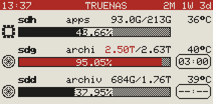 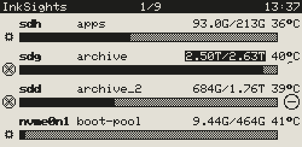

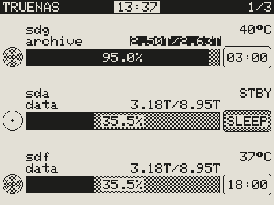

| Setting | Options | Notes |
|---|---|---|
| **Ink** | tick | Shows the drive pages on the display or not; their settings stay. |
| **Drive types** | HDD, SSD, NVMe, any combination | None = no drive pages. |
| **Icons** | On, Off | Symbol left of each bar. |
| **Details in bar** | On, Off | Text inside the bar, only where the bar is high and wide enough. |
| **Details** | Capacity, Percentage | The used capacity (e.g. 3.18T, the default) or the percentage used (e.g. 35%). |
| **Percentage** | 35%, 35.4%, 35.47% | Decimals of the percentage in the bar. |
| **Spindown timer** | On, Off | Hard disks only. Off = no timer, full-width bar. |
| **Timer style** | Ring, Badge | Ring (default): shrinks until spindown. Badge: time left as MM:SS. |
| **Ring direction** | Counterclockwise, Clockwise | For the ring (default counterclockwise). |
| **Temperature** | On, Off | The temperature of each drive (off by default); `--` = unknown. |
| **Asleep** | STBY, -- | What a hard disk that is asleep shows instead of its temperature. |
| **Color highlight** | on/off, from … % used | Bar and used/total are highlighted once a pool is this full. |
| **Order and visibility by** | Pool, UID, Device, Custom | The tick next to each disk shows or hides it on this display. Custom: drag a disk by its grip (two lines at the right), or the arrow keys on the grip. |

- **Drive types:** the number of drives of each type is shown in brackets.
- **Details** Capacity: the top right then shows only the total.
- **Percentage:**
  - cut, not rounded, so 99.99% is never shown as 100%
  - where the bar is too short, fewer decimals are shown
  - more decimals change more often, so the display redraws more often (at most every 3 minutes)
- **Temperature:**
  - at the right of the first text line, above the timer (upright in the pool line)
  - without the timer, used/total moves left to make room
  - hard disks need [drive-temp-export](#hdd-temperatures)
- **Asleep** is the same setting as **HDD asleep** in the System card.
- **Color highlight:** in the third colour on colour panels, inverted on black/white panels.
- **Order:** names like sda can change after a reboot, so Pool, UID and Custom use the serial number (UID); Device
  orders by name.

## Network card

Pages with one row per network interface (by default after the drive pages), as many rows per page as the drive
pages.

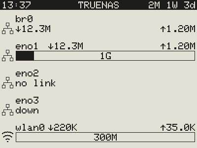 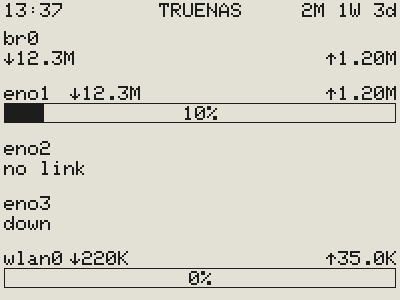

| Setting | Options | Notes |
|---|---|---|
| **Ink** | tick | Shows the network pages or not; their settings stay. |
| **Icons** | On, Off | Linked boxes for a wired interface, the WiFi symbol for a wireless one. |
| **Details in bar** | On, Off | Text inside the bar, only where the bar is high and wide enough. |
| **Details** | Percentage, Link speed | How busy the link is (e.g. 10%) or its speed (e.g. 1G). |
| **Order and visibility by** | Name, Custom | The tick next to each interface shows or hides it. At most 8. Custom: drag an interface by its grip, or the arrow keys on it. |

Each row shows:

- the interface, ↓ download and ↑ upload per second
- a bar with the busier direction of the link speed; none without a link speed (e.g. bridges or WiFi): the values
  then stand below the name
- **down** in the place of the bar when the interface is switched off, **no link** when it has no connection (no
  cable, or WiFi not connected to a network)

With the network pages on but no interface (none found, or all of them unticked) and no other page, the display
shows a page **No interfaces**, like **No drives** for the drive pages.

The same goes for the network row of the system page. Virtual interfaces (Docker, VMs) are left out.

## Docker card

Pages with one row per Docker container of the system, or one per stack (by default after the network pages), as
many rows per page as the drive pages.

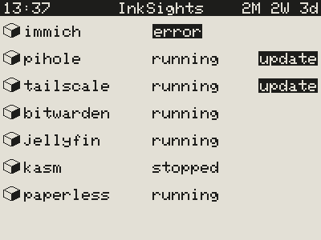 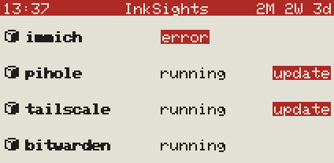 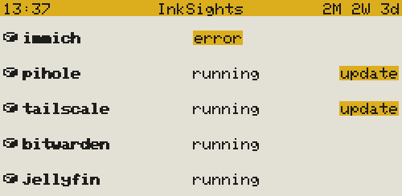

| Setting | Options | Notes |
|---|---|---|
| **Ink** | tick | Shows the Docker pages or not; their settings stay. |
| **Show** | All, Errors, Updates, Errors and updates | Which containers get a row. None to show: the page says **No containers**, **No errors**, **All up to date** or **All fine**. |
| **On cue** | tick | Not with All: the Docker page comes only while a container is shown (e.g. one with an error); else it leaves the page turn. |
| **Icons** | On, Off | A cube in front of each row. |
| **Rows** | Stacks, Containers | One row per container (default), or one per stack (Compose project): the containers of a stack together, with the name of the stack. A stack shows **error** when one of its containers has one, **running** when one runs (else **stopped**), **update** when one has a newer image. A container without a stack (started with `docker run`) keeps its own row. The line at the top of the page counts what the display of the tab shown has. |
| **Highlight** | On, Off | `error` and `update` in a box: white on black, or on the third colour with Color highlight (black on yellow). |
| **Color highlight** | On, Off | `error` and `update` in the third colour (colour panels only). |
| **Order and visibility by** | State, Name, Custom | State: errors first, then the ones with an update, then the others, each by name. The tick next to each container (or stack) shows or hides it. At most 24 on the display. Custom: drag a row by its grip, or the arrow keys on it. |

Each row shows:

- the name of the container (or the stack)
- its state: **running**, **error** (stopped with an error, restarting, dead or unhealthy) or **stopped** (stopped
  normally, created or paused)
- **update** at the right end when a newer image is out for it

Where it comes from:

- The script asks the Docker of the system for its containers at every full run (`docker ps -a`), with the stack
  each one belongs to. The card lists them, the line at the top of the page counts them.
- **Newer image:** the script asks the registry of each image (Docker Hub, ghcr.io, lscr.io, ...) for the
  fingerprint (digest) of its tag and compares it with the image on the system. Only that short question, nothing is
  downloaded. Every `INKSIGHTS_DOCKER_CHECK` minutes per image (default 360 = 6 hours, set in `docker-compose.yaml`,
  see [3 c)](../README.md#c-start-the-settings-page-and-the-script-as-a-docker-app)), at most 10 images per run, and only while a
  display shows the Docker pages. Script without Docker: put `INKSIGHTS_DOCKER_CHECK=60 ` in front of `/bin/bash`
  in its line.
- Images built on the system or pinned to a digest never show **update**. The system needs `curl` for the question.
- No Docker on the system: **No containers**.

## WiFi card

Boards with WiFi only: network, password, settings page, host name, setup access point on/off, failover access
point after (s), access point name and password. See [4. WiFi](../README.md#4-wifi-optional).

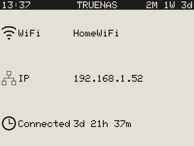

| Setting | Options | Notes |
|---|---|---|
| **Ink** | tick | An extra page (by default the last). The WiFi settings apply either way. |
| **Icons** | On, Off | Symbol at the left of each row. |

The WiFi page has three rows:

- **WiFi:** the network, or the setup access point
- **IP:** the address
- **Connected:** how long the board has been connected without a break

Only boards with WiFi draw it. It is redrawn when one of the rows changes (black/white panels about every minute,
colour panels at most every 3 minutes).

## The Conversation, The Intermission and The Afterhours cards

Each picture has a card named after it, with the screen as this display shows it:

| Card | Picture | Shown |
|---|---|---|
| **The Conversation** | three people at a table | when every page is switched off (Nothing to ink) |
| **The Intermission** | the empty table | when no fresh data come (Check connection) |
| **The Afterhours** | the chairs upside down on the table | in its time window (quiet hours) |

**Ink** says whether the picture is used at all (ticked by default). The settings in the card:

| Setting | Default | What it does |
|---|---|---|
| **Turn candidate** | on | The picture as a page of its own in the page turn, at the place of its card. |
| **Header** | on | The top line above the picture. |
| **Caption** | on | The text below the picture: `Nothing to ink`, `Check connection`, `Closed until 07:00`. |
| **Got the time?** | off | A wall clock showing the time now, in all three pictures at the same place (above the left chair of The Afterhours). |
| **On cue** | on | The Conversation when every page is off, The Intermission when no fresh data come. Not on The Afterhours. |
| **Scheduled**, **From**, **To** | off | In this time window only this picture shows, without page turns. It may go past midnight. |

- **Several cases at once:** a time window comes first, then **On cue**, then the page turn.
- **No overlaps:** the time windows of a display must not overlap; the page does not save them until they don't.
- **The Afterhours:** in its time window the caption says `Closed until` and the end, in the time format of the
  display (`07:00`, `07:00AM`). The time is never left out: where the line is too wide, the time goes to a second line.
- **Got the time?** (off by default, per picture): the wall clock goes on with the time, so the display redraws the
  picture while it is shown: black/white panels every minute without flashing, colour panels as often as their
  **Refresh** says (at least every 3 minutes, each time with the flashing full refresh). Leave it off to spare the
  panel: then the picture stays as it is. The clock takes the time of the last data, counted on by the board.
- **Fixed places:** every picture has its fixed place on a display, the same with or without top line or caption,
  and all captions start on the same line below it. On every 2.13″ the captions are 5x7, on the 4.2″ three times
  that.
- **Every page off and The Conversation not on cue:** the product name with its logo instead of an empty
  panel (see [Good to know](../README.md#good-to-know)).
- **On cue** off: The Conversation off shows the logo; The Intermission off lets the display go on with its
  pages (and turn them) without fresh data.
- The board decides the time windows itself with the time of its last data, so a window also begins and ends
  between two updates.

## Advanced Ink card

Framed sections:

- In one row: **Screens** (whether the display shows its start screen after power-up, ticked by default), **Bar
  behaviour** (**Auto collapse**) and **Beverages** (see [Beverages](#beverages)).
- **OTA Update:** new firmware over WiFi, see below.
- **Backup** of the display's settings (see below).
- **Remove** (beside Backup, only for a display that is not connected): **Remove display** takes it and its settings off the page
  (with *Save*), e.g. an old display that is no longer plugged in. When it is connected again, it shows up again,
  with the settings of a new display.
- **Frame** (folded, at the end): what the display receives, over USB or WiFi.

| Setting | Off means |
|---|---|
| **Start screen** | After power-up the board draws nothing; the panel keeps its last picture until the first data arrive. |
| **Auto collapse** (Bar behaviour) | On (default): opening a card of this display folds its other cards, so only one is open at a time. |

- **Start screen:** the board stores this setting, so it applies from the next power-up on. A board with WiFi whose
  time page uses NTP also stores the clock: it then shows the time right after power-up, even without the system
  (once NTP has the time).
- **Auto collapse** is remembered in this browser (not in the backup), no need to save.

**Backup:**

- **Export** saves the settings of this display as a JSON file, with the InkSights version it was made with:
  - name: `inksights-v<version>-<name>-<chip id>-<date>.json`, e.g.
    `inksights-v1.1.0-living-room-1a2b3c4d-2026-10-26.json` (the name only when the display has one)
  - WiFi passwords are not in it: they never reach the page
- **Import** reads such a file into this display, also one of another board (e.g. after replacing a board, which
  has a new chip ID):
  1. It is checked first: an InkSights backup of a display, then every setting by the app with the same rules as
     saving. Settings an older backup does not have get their defaults.
  2. A valid file becomes this display's settings on the page as unsaved changes, its display name included.
  3. Check the preview (and the display pins, when it came from another kind of board) and press **Save**.
  4. The WiFi passwords stored on the system stay.

**OTA Update** (boards with WiFi that fetch their data over WiFi):

- **OTA** On / Off: Off = no firmware updates of this display from the page (saved with *Save*; with the login on,
  only someone with the login can switch it on again). On by default.
- Right of **Update firmware**: **Firmware up to date.**, or **New firmware available!** in green. Only then a line
  below says why it cannot be flashed from here, if so (e.g. `Seeed XIAO SAMD21 has no WiFi: update it over USB.`).
- OTA only means updates over WiFi. Flashing over USB (see [2.](../README.md#2-upload-the-firmware)) is not affected by it.
- **Update firmware** flashes the firmware the settings page brings with it, the same version as the page. The board
  fetches it within 30 seconds, checks it, flashes it and restarts; when anything goes wrong it keeps the old one.
  The button only works when the firmware fits this board and the board is on the WiFi.
- **Manual update:** **Choose file** takes a firmware file from your computer, the release file
  (`inksights-v<version>-<board>-factory.bin`) or the `firmware.bin` of a build. The page checks it first: an
  ESP32 firmware for this chip and this board, small enough for its firmware slot. The result stands below the buttons:
  **Firmware valid.** in green, then **Upload** flashes it.
- While it runs, the frame shows `Waiting for the board`, then `Loading firmware … %`, then `Updated` or `Update
  failed` with the reason. The board checks size and checksum before it switches; the old firmware stays when the
  download breaks off.
- The Docker image carries the firmware of every board with WiFi (built with the image). Running the settings page
  from a folder of the repository it carries none: then only **Manual update** works.
- With `INKSIGHTS_OTA=off` in the Docker settings the frame only says **Switched off on the server.** and nothing can be
  flashed from the page (see [Security](../README.md#security)).

## Beverages

In the [Advanced Ink card](#advanced-ink-card), frame **Beverages**: what stands on the table of The Conversation,
The Intermission and The Afterhours.

| Choice | On the table |
|---|---|
| **House Wine** | the wine bottle and the glass |
| **Roast** (default) | a coffee cup |
| **Tabula Rasa** | nothing: no bottle, no glass, no cup |

A display often stands at work, in a shared room, in a school, or in front of people who do not drink, who stopped
drinking, or who simply do not want to be reminded of it. InkSights respects that and takes it into account from
the start: the pictures come with a coffee cup by default, show the bottle only when you choose **House Wine**, and
**Tabula Rasa** leaves the table empty.

**Roast:** the cup stands at the right edge of the table, in The Afterhours on the table between the chairs and
without steam (a cold cup left at closing time). It is the same cup in every picture, in the third colour on colour
panels, black on black/white panels; on the 4.2″ in 2 x 2 pixels. The choice applies per display, to all three
pictures, also to their previews in the cards.

## Simulator

`simulator/simulator.html` opens in any browser straight from the folder. It is the same settings page with
simulated data. Nothing is sent anywhere, except to a board on USB.

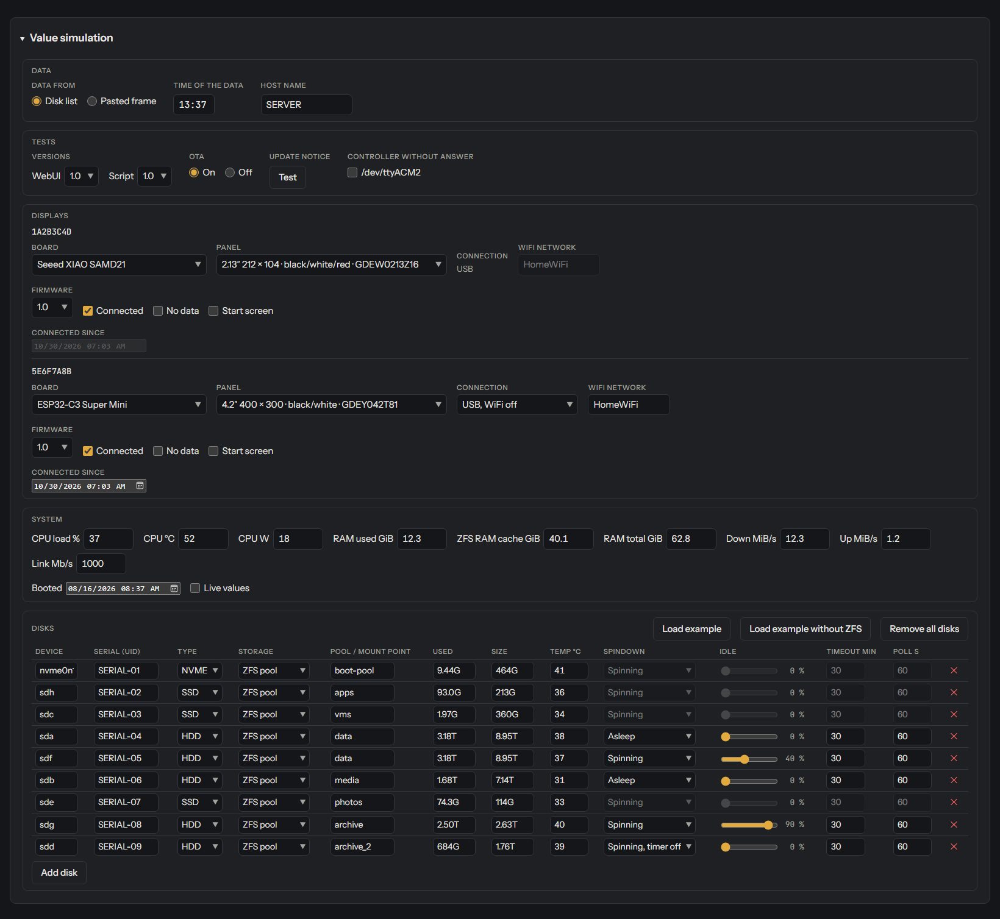

The **Value simulation** card below the displays has these frames:

- **Data:** disk list or a frame pasted from a dry run, the time of the data, the host name.
- **Tests:**
  - **Versions** sets the version of the WebUI and of the script. Below the status line the page then shows which
    versions run, and a notice for every one that does not match the WebUI, with **Latest release** (the release
    page on GitHub).
  - **OTA** Off: as if `INKSIGHTS_OTA=off` were set in the Docker settings (firmware updates switched off on the
    server).
  - **Update notice · Test** shows the line about a new version (one version after the installed one, or after a
    skipped one).
  - **Controller without answer** adds a port that does not answer (e.g. old firmware).
- **Displays**, per display:
  - board, panel, connection and WiFi network
  - **Firmware:** the version of its firmware
  - **Connected** off: what it draws when it gets no fresh data any more (NO DATA, Check connection)
  - **No data** at a connected one: the "Nothing to ink" screen (nothing to show)
  - **Start screen:** what it shows after power-up until the first data arrive
  - **Connected since:** for the WiFi page
- **System:** the system values and when the server started. **Live values** = a running system: displays with a
  refresh in seconds show changing system values, drive temperatures and counting-down spindown timers, as often as
  they refresh.
- **Disks:** the drives (with or without ZFS), each with storage, usage, temperature (column **Temp °C**) and spindown
  state.
- **Containers:** Docker containers for the Docker pages, each with its name, its stack, its state (running, error,
  stopped) and whether an update is out; **Add container**, **Load example**.

Also in the simulator:

- The simulated interfaces cover every case: wired, no cable, switched off, a bridge and WiFi.
- The Value simulation card folds (the triangle next to its heading).
- The **USB** card at the bottom is the [USB setup](../README.md#usb-setup), plus **Send to display**: it sends what a simulated
  display gets to the real board, so the display shows it right away (without "NO DATA" later, as the simulated time
  does not move). Chrome or Edge only.

## System page

One extra page (by default after the time page) with the ticked rows; sizes like a drive page with as many rows:

| Row | Left | Middle | Right | Bar |
|---|---|---|---|---|
| CPU | `CPU` | temperature, power | load | load |
| RAM | `RAM` | ZFS RAM cache (shown as `ZFS`) | used by programs / total | black = programs, grey = ZFS RAM cache, light = free |
| Network | interface | ↓ download per second | ↑ upload per second | the busier direction of the link speed |
| NVMe | `NVMe` | temperature of each NVMe drive | - | - |
| SSD | `SSD` | temperature of each SATA / SAS SSD | - | - |
| HDD | `HDD` | temperature of each hard disk, `--` or `STBY` when asleep | - | - |

- **Icons:** a processor for CPU, a memory module for RAM, linked boxes for the network, the chip for NVMe and SSD,
  the disc for HDD (light when all hard disks are asleep, grey as soon as one runs).
- **Temperatures** stand after the name (upright: below it), at most six per row. A temperature row without such
  drives is left out, and the other rows get bigger.
- **Network row:**
  - without a link speed (e.g. bridges) its values stand below the name instead of a bar
  - "down" / "no link" instead of the bar when the interface is off or has no connection
  - a wireless interface gets the WiFi symbol instead of the linked boxes

**Where the values come from:** `/proc` and `/sys`, never from the hard disks.

- **RAM:** ZFS uses almost all free memory as cache and gives it back when programs need it, so it is shown apart
  (can be switched off per display). Systems without ZFS simply show no cache.
- **Power:** what the processor itself uses (Intel, newer AMD), not the whole server. Not available in virtual
  machines.
- **CPU temperature:** Intel (`coretemp`), AMD (`k10temp`, `zenpower`) or the CPU sensor of ARM boards.
- **NVMe temperature:** read from the NVMe driver at most every 30 seconds (a tiny request to the NVMe drive; no
  moving parts, it does not wake anything).
- **SSD temperature:**
  - only when a display shows the SSD row, at most every 30 seconds, with `smartctl` (TrueNAS has it; without it
    the row stays empty)
  - only drives the system reports as SSD are asked, with `-n standby` (a drive that says it is asleep is not asked)
  - hard disks are never asked
- **HDD temperature:** see below.
- **Load, power and network** are averages since the previous reading: over seconds with fast refresh, otherwise
  since the last update. Unknown values show `--` or are left out.
- The preview on the settings page shows the values of the last full update.

### HDD temperatures

InkSights never asks a hard disk anything itself, so it does not wake one. It takes hard disk temperatures from
[drive-temp-export](https://github.com/Gittegatt/drive-temp-export):

- a separate tool that asks only spinning hard disks (`smartctl -n standby`: a sleeping disk is not asked) and
  writes a status file
- when it runs on the system, InkSights reads that file: `/run/system-metrics/output/disk-temp/status`
  (another place: set `DRIVE_TEMP_STATUS` for the script)

What the display shows:

- a disk the tool reports as active: its temperature
- one that is asleep (for the tool or for the spindown timer): `--`, or `STBY` with **Asleep** / **HDD asleep** set
  to STBY
- a status file older than 5 minutes counts as missing: then the HDD row of the system page is left out and the
  drive pages show `--` for hard disks

SSD and NVMe temperatures do not need it.
