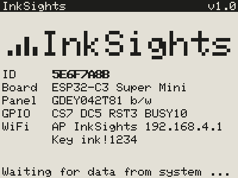
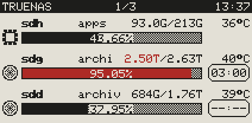
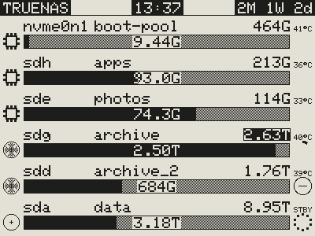
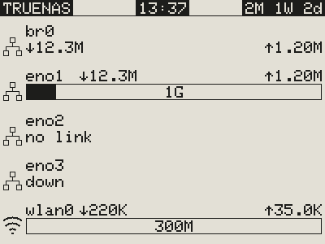
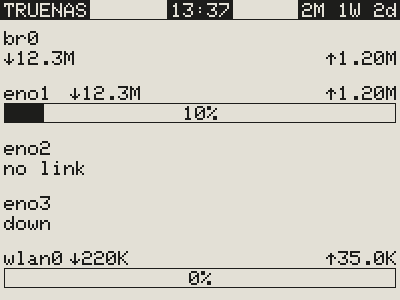
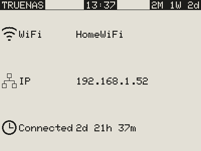

# Examples

What the displays show, drawn with the preview of the settings page (the same drawing as on the display). All
names and values are examples.

[Back to the README](../README.md)

### 4.2″ start screen with the setup access point

After power-up, until the first data arrive: ID of the display, board, panel type, display pins and the WiFi
state. No WiFi set up yet, so the board has opened its access point **InkSights** at 192.168.4.1 and shows its
password.

### 2.13″ system page

CPU with temperature, power and load, RAM with the ZFS cache (grey), the network interface with download and
upload, and the temperatures of the NVMe drive, the SSDs and the hard disks; hard disks that are asleep show
`STBY`. Top line: title, page number, time.

### 2.13″ drive page with highlight

One row per drive: symbol, device, pool, used/total, temperature and the bar with the percentage (two
decimals). The pool above 85 % is highlighted in the third colour: its bar and its used capacity. Right: the spindown timer of the hard disks
(time left, `--:--` = timer not running); the SSD at the top has the chip symbol and no timer.

### 4.2″ drive pages

The used capacity inside the bar, the total at the right, the temperature beside it. A pool above 85 % shows
its total inverted (black/white panel). Spindown timer as a ring: shrinking ring = time left, circle with a
dash = timer not running, dotted circle = asleep (temperature `STBY`). Inverted top line with highlighted
places: title, time, uptime.

### 4.2″ network page

One row per network interface with download and upload, the link speed inside the bar. A bridge (br0) has no
link speed, so its values stand below the name; **no link** = no cable or not connected, **down** = switched
off. The wireless interface gets the WiFi symbol.

### 4.2″ network page without symbols

The same page without symbols, with how busy the link is (percentage) inside the bar.

### 4.2″ WiFi page

The WiFi network the board is connected to, its IP address and how long it has been connected without a break.
Shown in the preview so far; the firmware does not draw this page yet.
