# Examples

What the displays show, drawn with the preview of the settings page (the same drawing as on the display), and
the settings page itself. The 2.13″ pictures are shown at twice their size. All names and values are examples.

[Back to the README](../README.md)

## Start screen

### 4.2″ start screen with the setup access point

After power-up, until the first data arrive: ID of the display, board, panel type, display pins and the WiFi
state. No WiFi set up yet, so the board has opened its access point **InkSights** at 192.168.4.1 and shows its
password.

## System page

### 2.13″ system page

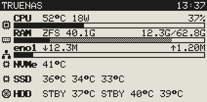

CPU with temperature, power and load, RAM with the ZFS cache (grey), the network interface with download and
upload, and the temperatures of the NVMe drive, the SSDs and the hard disks; hard disks that are asleep show
`STBY`. Top line: title and time.

### 2.13″ system page with a red top line

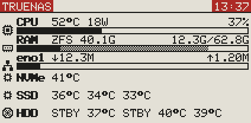

The same page with **Invert colors** and **Highlight color** in the Header card: a white top line, its highlighted
places (title, time) in the third colour with white text.

## Drive pages

### 2.13″ drive page with highlight

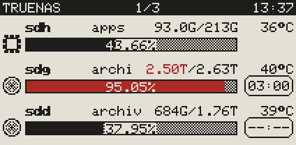

Three rows per page: symbol, device, pool, used/total, temperature and the bar with the percentage (two
decimals). The pool above 85 % is highlighted in the third colour: its bar and its used capacity. Right: the
spindown timer of the hard disks as a badge (time left, `--:--` = timer not running); the SSD at the top has the
chip symbol and no timer.

### 2.13″ drive page with a red top line, gaps filled

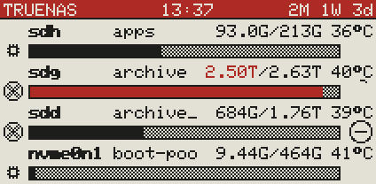

**Fill gaps** in the Header card: the whole top line in the third colour, with title, time and uptime. Four rows
(too low for text inside the bar), the spindown timer as a ring: shrinking ring = time left, circle with a dash =
timer not running.

### 2.13″ drive page with yellow

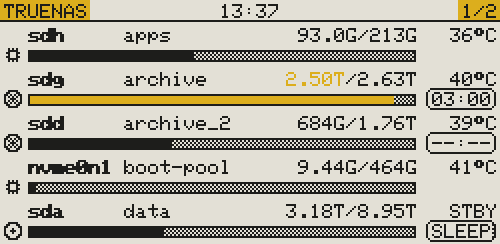

A 250×122 panel with yellow as third colour, five rows: the pool above 85 % gets a yellow bar, the highlighted
places of the top line (title, page number) yellow boxes; text on yellow is black. Asleep hard disks show `STBY`
and `SLEEP`.

### 4.2″ drive page

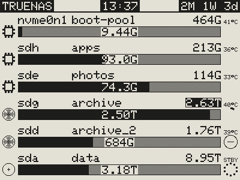

Six rows in a custom order. The used capacity inside the bar, the total at the right, the temperature beside it. A
pool above 85 % shows its total inverted (black/white panel). Spindown timer as a ring; a dotted circle = asleep.
Inverted top line with highlighted places: title, time, uptime.

### 4.2″ drive page with three rows

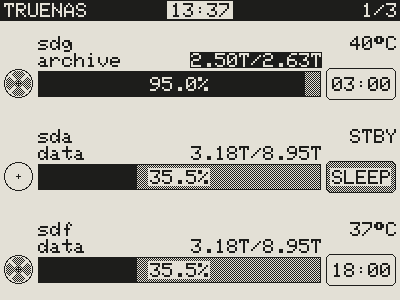

Fewer rows per page: bigger bars, symbols and timers, readable from further away. The pool stands below the device,
the percentage with one decimal inside the bar, the timer as a badge. Black top line with the time highlighted.

### 2.13″ drive page without ZFS

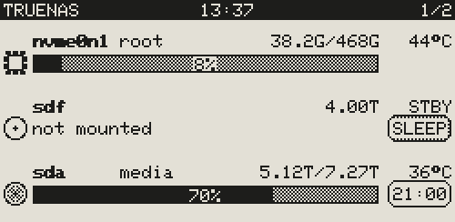

A Linux server without ZFS: each disk shows the filesystem mounted on it, named after its mount point (`/` =
`root`). A disk with nothing mounted shows its size and **not mounted** instead of a bar.

### 2.13″ upright

Turned by 90° in the Display card: device and used/total in the first line, the pool in its own line, the bar and
timer below. Top line: title and page number.

## Network and WiFi pages

### 4.2″ network page

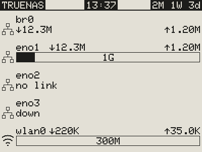

One row per network interface with download and upload, the link speed inside the bar. A bridge (br0) has no
link speed, so its values stand below the name; **no link** = no cable or not connected, **down** = switched
off. The wireless interface gets the WiFi symbol.

### 4.2″ network page without symbols

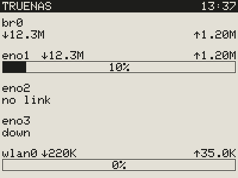

The same page without symbols, with how busy the link is (percentage) inside the bar, and a black top line.

### 4.2″ WiFi page

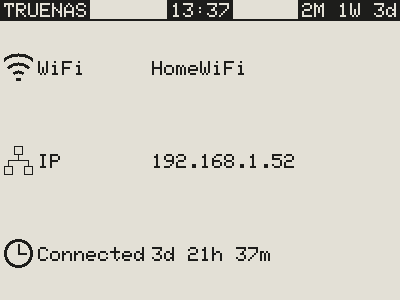

The WiFi network the board is connected to, its IP address and how long it has been connected without a break.
Shown in the preview so far; the firmware does not draw this page yet.

## Time page

### 4.2″ time page

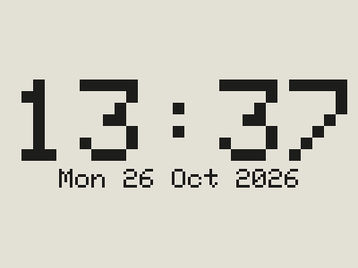

**Just give me time** in the Advanced Ink card: the display shows only the time page, in 24 hours, with the weekday
and the date. Like every time page, without the top line (the Time card's **Header** tick is off by default).

### 2.13″ time page in 12 hours

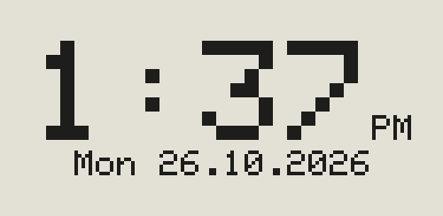

**12h** with AM/PM in the Display card, the date as `26.10.2026`. Here the time page comes first (its card dragged
to the top); the system and drive pages follow, with their top line.

## Special screens

### 2.13″ upright without connection

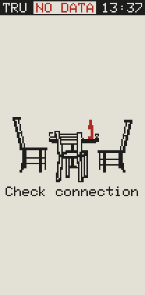

The display got no fresh data for too long: **NO DATA** in the top line (in the third colour) and **Check
connection** below a picture of the empty table. The time is when the last data came. Turned by 90° in the
Display card, the display keeps its sizes.

### 4.2″ with nothing to show

Every page of this display is switched off (no system, drive, network, time or WiFi page): **Nothing to ink** below
a picture of three people at a table, so the display never looks broken.

## Settings page and simulator

### The settings page

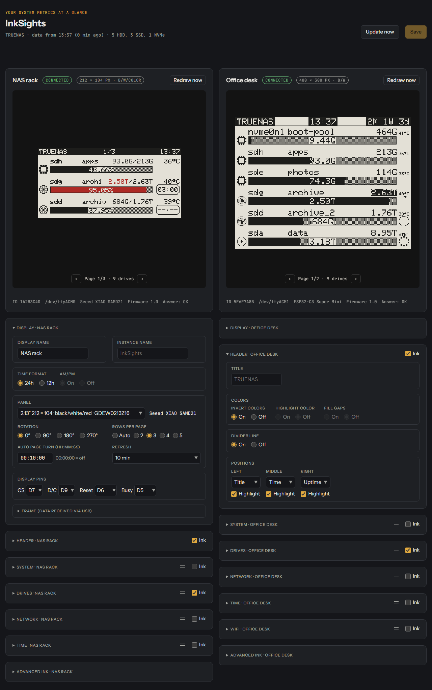

Two displays with their live previews; below each its cards, here the **Display** card open on the left (names,
time format, panel, rotation, rows per page, page turn, refresh, display pins) and the **Header** card on the
right (title, colors, divider line, positions). The other cards are folded, each with its **Ink** tick that
switches that page on or off and its grip (two lines) to change the order of the pages.

### The simulator

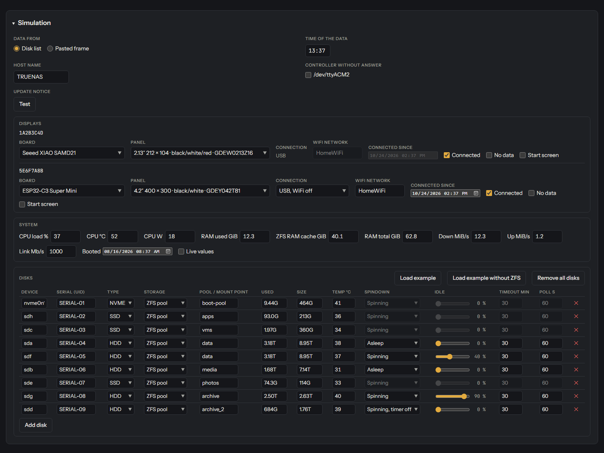

`simulator/simulator.html` is the same settings page with simulated data; its **Simulation** card sets them: where
the data come from (disk list or a pasted frame), the time and host name, a controller that does not answer, per
display the board, panel, connection, WiFi network and **Connected** / **No data** / **Start screen**, the system
values (**Live values** = a running system) and the drives with storage, usage, temperature and spindown state.
**Update notice · Test** shows the line about a new version.
