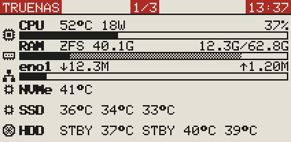
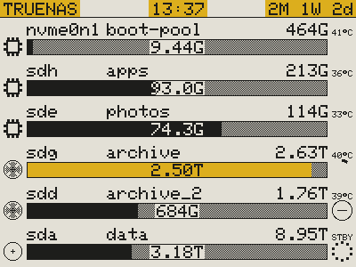
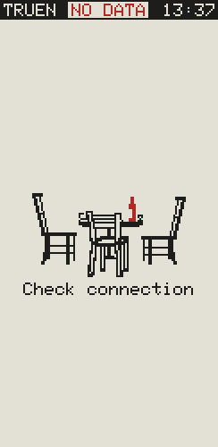
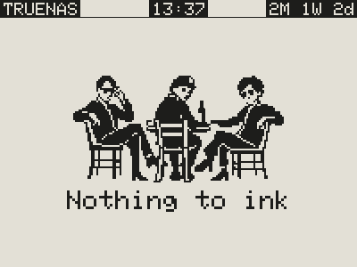
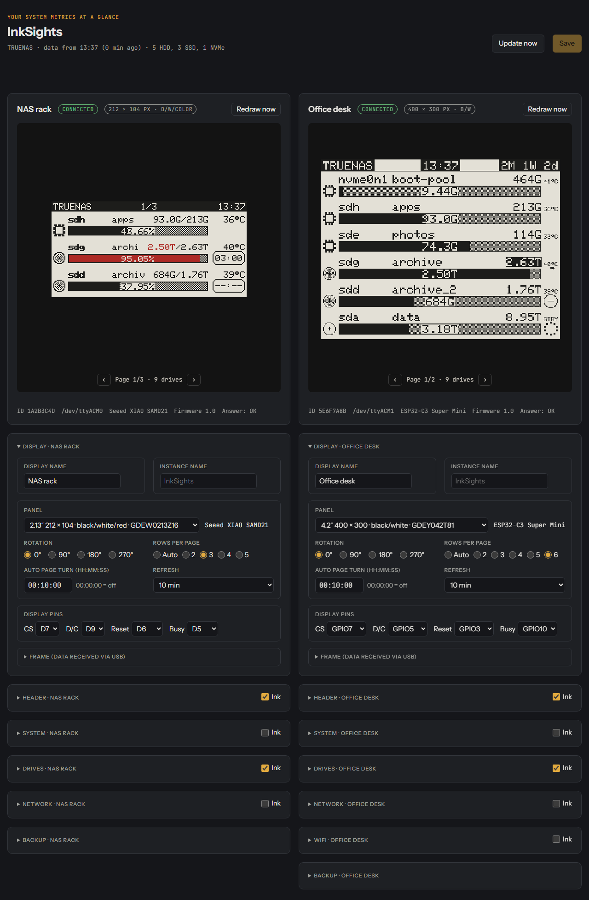
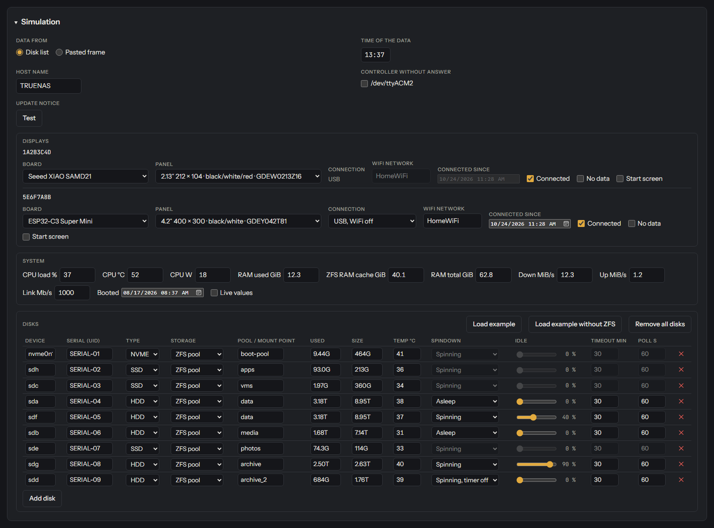

# Examples

What the displays show, drawn with the preview of the settings page (the same drawing as on the display), and
the settings page itself. All names and values are examples.

[Back to the README](../README.md)

### 4.2″ start screen with the setup access point

After power-up, until the first data arrive: ID of the display, board, panel type, display pins and the WiFi
state. No WiFi set up yet, so the board has opened its access point **InkSights** at 192.168.4.1 and shows its
password.

### 2.13″ system page

CPU with temperature, power and load, RAM with the ZFS cache (grey), the network interface with download and
upload, and the temperatures of the NVMe drive, the SSDs and the hard disks; hard disks that are asleep show
`STBY`. Top line: title, page number, time.

### 2.13″ system page with a red top line

The same page with **Invert colors** and **Highlight color** in the Header card: a white top line, its highlighted
places (title, page number, time) in the third colour with white text.

### 2.13″ drive page with highlight

One row per drive: symbol, device, pool, used/total, temperature and the bar with the percentage (two
decimals). The pool above 85 % is highlighted in the third colour: its bar and its used capacity. Right: the spindown timer of the hard disks
(time left, `--:--` = timer not running); the SSD at the top has the chip symbol and no timer.

### 4.2″ drive pages

The used capacity inside the bar, the total at the right, the temperature beside it. A pool above 85 % shows
its total inverted (black/white panel). Spindown timer as a ring: shrinking ring = time left, circle with a
dash = timer not running, dotted circle = asleep (temperature `STBY`). Inverted top line with highlighted
places: title, time, uptime.

### 4.2″ drive pages with yellow

The same page as it would look with yellow as third colour: the pool above 85 % gets a yellow bar, the highlighted
places of the top line yellow boxes; text on yellow is black. The 4.2″ panel InkSights supports is black/white, so
this shows the colour rules rather than a panel you can buy for it today.

### 4.2″ network page

One row per network interface with download and upload, the link speed inside the bar. A bridge (br0) has no
link speed, so its values stand below the name; **no link** = no cable or not connected, **down** = switched
off. The wireless interface gets the WiFi symbol.

### 4.2″ network page without symbols

The same page without symbols, with how busy the link is (percentage) inside the bar.

### 4.2″ WiFi page

The WiFi network the board is connected to, its IP address and how long it has been connected without a break.
Shown in the preview so far; the firmware does not draw this page yet.

### 2.13″ upright without connection

The display got no fresh data for too long: **NO DATA** in the top line (in the third colour) and **Check
connection** below a picture of the empty table. The time is when the last data came. Turned by 90° in the
Display card, the display keeps its sizes.

### 4.2″ with nothing to show

Every page of this display is switched off (no system, drive, network or WiFi page): **Nothing to ink** below a
picture of three people at a table, so the display never looks broken.

### The settings page

Two displays with their live previews; below each its cards, here the **Display** card open (names, panel, rotation,
rows per page, page turn, refresh, display pins) and the others folded, each with its **Ink** tick that switches
that page on or off.

### The simulator

`simulator/simulator.html` is the same settings page with simulated data; its **Simulation** card sets them: where
the data come from (disk list or a pasted frame), the time and host name, a controller that does not answer, per
display the board, panel, connection, WiFi network and **Connected** / **No data** / **Start screen**, the system
values (**Live values** = a running system) and the drives with storage, usage, temperature and spindown state.
**Update notice · Test** shows the line about a new version.
