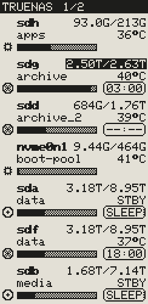

# Examples

What the displays show, drawn with the preview of the settings page (the same drawing as on the display), and
the settings page itself. The pictures of the displays are shown 400 pixels wide (the upright one at twice its
size), the three versions of each picture side by side. All names and values are examples.

Every top line here is one continuous line without a divider line: on red and yellow panels mostly in the third
colour (**Invert colors**, **Color highlight** and **Fill gaps** in the Header card), otherwise white
(**Invert colors**) or black. Mostly left the time, in the middle the title, right the uptime (the defaults); four
pictures show the page number instead, each in another place (system page, ring timers, 4.2″ drive page, network
page). The page count includes the three pictures, which are Turn candidates by default. A time page has no top
line.

[Back to the README](../README.md)

## Start screen

### 4.2″ start screen with the setup access point

After power-up, until the first data arrive: ID of the display, board, panel type, display pins and the WiFi
state. No WiFi set up yet, so the board has opened its access point **InkSights** at 192.168.4.1 and shows its
password.

## System page

### 2.13″ system page

CPU with temperature, power and load, RAM, the network interface with download and upload, and the
temperatures of the NVMe drive, the SSDs and the hard disks; hard disks that are asleep show `STBY`. The top line
in red over its whole width.

### 2.13″ system page with a white top line

A black/white 250×122 panel with **Invert colors**: black text on a white top line. **ZFS RAM cache** is on here:
the grey part of the RAM bar is the cache.

## Drive pages

### 2.13″ drive page with highlight

Three rows per page: symbol, device, pool, used/total, temperature and the bar with the percentage (two
decimals). The pool above 85 % is highlighted in the third colour: its bar and its used capacity. Right: the
spindown timer of the hard disks as a badge (time left, `--:--` = timer not running); the SSD at the top has the
chip symbol and no timer.

### 2.13″ drive page with spindown rings

A black/white panel, four rows, the spindown timer as a ring: shrinking ring = time left, circle with a dash =
timer not running. The pool above 85 % shows its used/total inverted. Black top line.

### 2.13″ drive page with yellow

A 250×122 panel with yellow as third colour, five rows: the top line and the pool above 85 % in yellow; text on
yellow is black. Asleep hard disks show `STBY` and `SLEEP`.

### 4.2″ drive page

Six rows in a custom order. The used capacity inside the bar, the total at the right, the temperature beside it. A
pool above 85 % shows its total inverted (black/white panel). Spindown timer as a ring; a dotted circle = asleep.
White top line.

### 4.2″ drive page with three rows

Fewer rows per page: bigger bars, symbols and timers, readable from further away. The pool stands below the device,
the percentage with one decimal inside the bar, the timer as a badge. Black top line.

### 2.13″ drive page without ZFS

A Linux server without ZFS: each disk shows the filesystem mounted on it, named after its mount point (`/` =
`root`). A disk with nothing mounted shows its size and **not mounted** instead of a bar. No spindown timer (the
default), so the bars reach to the right edge.

### 2.13″ upright

Turned by 90° in the Display card: device and used/total in the first line, the pool in its own line, the bar and
timer below.

## Network and WiFi pages

### 4.2″ network page

One row per network interface with download and upload, the link speed inside the bar. A bridge (br0) has no
link speed, so its values stand below the name; **no link** = no cable or not connected, **down** = switched
off. The wireless interface gets the WiFi symbol.

### 4.2″ network page without symbols

The same page without symbols, with how busy the link is (percentage, the default) inside the bar, and a white
top line.

### 4.2″ WiFi page

The WiFi network the board is connected to, its IP address and how long it has been connected without a break.

## Time page

### 4.2″ time page

**Just give me time** in the Time card: the display shows only the time page, in 24 hours, with the weekday
and the date (`2026-10-26`, the default).

### 2.13″ time page in red, 12 hours

**Color highlight** and **Time frame** in the Time card: the time in red with a black outline, weekday and date in
black. **12h** with AM/PM in the Time card, the date as `28.10.2026`. The time page comes first (the default
order); the other pages follow, with their top line.

## Special screens

The pictures of this part without the top line (the default), three per screen: **House Wine** (the bottle and the
glass, no caption), **Roast** (a coffee cup, the default of **Beverages** in Advanced Ink, with its **Caption**, 5x7
on the 2.13″) and **Tabula Rasa** (nothing on the table) with its **Caption** and **Got the time?** (a wall clock
with the time now).

### The Conversation: 4.2″ with nothing to show

  

Every page of this display is switched off (no system, drive, network, time or WiFi page): **The Conversation**,
three people at a table, with **Nothing to ink** as its caption, so the display never looks broken.

### The Intermission: 2.13″ without connection

  

The display got no fresh data for too long: **The Intermission**, the empty table, with **Check connection** as
its caption; on this red panel the bottle and the cup in red. With its **Header** ticked the top line shows
**NO DATA**.

### The Afterhours: 2.13″ in its quiet hours

  

**The Afterhours** with **Scheduled** 23:00 to 07:00, at 23:37: only its picture, the chairs up on the table, with
its caption **Closed until 07:00AM** (**12h** with AM/PM in the Time card); on this yellow panel the bottle and the
cup in yellow. With **Roast** a cold cup (no steam) stands between the chairs.

### InkSights: 2.13″ with nothing to show, without the picture

Every page switched off and **The Conversation** with **On cue** off: the product name with its logo, in the
place it keeps with or without the top line.

## Docker pages (simulator so far)

  

One row per Docker container: its name, its state (running, error, stopped) and **update** when a newer image is
out, errors first, then the ones with an update. On the left a 4.2″ with every container, **Highlight** on (error and
update in black boxes) and a black top line; on the right a red 2.13″ with **Highlight**: error
and update in red boxes; below it the same on a yellow 2.13″, black text on the yellow boxes. So far only in the simulator, not on the real settings page.

## Settings page and simulator

### The settings page

 

The settings page with two displays, one tab each (green dot = connected): at the top the versions of the WebUI,
the script and the firmware on each controller, then the tab of a display with its live preview on the left (it
stays in view while the page scrolls) and its cards on the right. On the left picture the 2.13″ with its
**Display** card open (names, panel, rotation, rows per page, refresh, page turn, Sync with display, display
pins), on the right picture the 4.2″ with its **Header** card open (title, places, colours, divider line). The
other cards are folded, each with its **Ink** tick that switches that page on or off and its grip (two lines) to
change the order of the pages. Below the page cards the cards of the three pictures (**The Conversation**, **The
Intermission**, **The Afterhours**) and **Advanced Ink**. At the bottom, for the whole page, the **Login** card
(the login of the page, off by default) and the **About** card (versions, project links, license, support), both
folded.

### The simulator

`simulator/simulator.html` is the same settings page with simulated data; its **Value simulation** card sets
them: where the data come from (disk list or a pasted frame), the time and host name, a controller that does not
answer, per display the board, panel, connection, WiFi network and **Connected** / **No data** / **Start screen**,
the system values (**Live values** = a running system) and the drives with storage, usage, temperature and
spindown state.
**Update notice · Test** shows the line about a new version.
